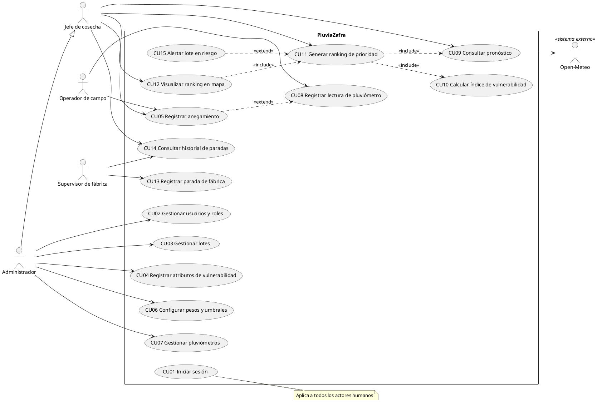

# PluviaZafra: Modelado de casos de uso

Proyecto: Ingenio La Esperanza (nombre provisorio PluviaZafra). Equipo: Carpincho Software.

Los puntos entre corchetes están pendientes de confirmar en la entrevista.

## Actores

- **Jefe de cosecha** (planificador): consulta el ranking y decide el orden de cosecha. Actor principal. [confirmar el cargo real en el ingenio]
- **Operador de campo**: carga lecturas de pluviómetro y reporta anegamientos.
- **Supervisor de fábrica**: registra las paradas con causa y duración.
- **Administrador**: gestiona usuarios, lotes y parámetros del índice.
- **Open-Meteo** (actor secundario, sistema externo): provee el pronóstico.

Firebase Auth no es actor, es infraestructura. El inicio de sesión se modela como un único caso de uso, sin `include` desde todos los demás.

## Casos de uso

| Código | Caso de uso | Actor |
|---|---|---|
| CU01 | Iniciar sesión | Todos los humanos |
| CU02 | Gestionar usuarios y roles | Administrador |
| CU03 | Gestionar lotes (alta, modificación, baja, ubicación en el mapa) | Administrador |
| CU04 | Registrar atributos de vulnerabilidad del lote (suelo, drenaje, camino de acceso) | Administrador |
| CU05 | Registrar anegamiento histórico | Jefe de cosecha, Operador |
| CU06 | Configurar pesos y umbrales de lluvia | Administrador |
| CU07 | Gestionar pluviómetros | Administrador |
| CU08 | Registrar lectura de pluviómetro | Operador de campo |
| CU09 | Consultar pronóstico | Jefe de cosecha, Open-Meteo |
| CU10 | Calcular índice de vulnerabilidad | (interno) |
| CU11 | Generar ranking de prioridad de cosecha | Jefe de cosecha |
| CU12 | Visualizar ranking en el mapa | Jefe de cosecha |
| CU13 | Registrar parada de fábrica | Supervisor de fábrica |
| CU14 | Consultar historial de paradas | Jefe de cosecha, Supervisor, Administrador |
| CU15 | Alertar lote en riesgo | (extiende CU11) |

## Relaciones

- CU11 `<<include>>` CU10 y CU09 (la lluvia acumulada sale de las lecturas de CU08).
- CU12 `<<include>>` CU11.
- CU15 `<<extend>>` CU11, con punto de extensión "lluvia acumulada + pronóstico superan el umbral del lote".
- CU05 `<<extend>>` CU08, con la condición "el operador observa un lote intransitable".
- El Administrador hereda del Jefe de cosecha. [válido si en la entrevista confirman que no hay separación estricta]

Regla práctica: `include` es obligatorio y lo invoca el caso base; `extend` es opcional y el caso base no lo conoce.

## Diagrama (PlantUML)

## Especificación: CU11 Generar ranking de prioridad de cosecha

- **Actor principal:** Jefe de cosecha.
- **Actor secundario:** Open-Meteo.
- **Precondición:** sesión iniciada, hay lotes con atributos cargados.
- **Flujo principal:**
  1. El jefe solicita el ranking.
  2. El sistema obtiene el pronóstico de lluvia de cada lote (CU09).
  3. El sistema suma la lluvia caída según las lecturas del pluviómetro asociado.
  4. El sistema calcula el índice de cada lote (CU10).
  5. El sistema combina índice, pronóstico y lluvia acumulada y ordena los lotes.
  6. El sistema muestra el ranking.
- **Flujos alternativos:**
  - 2a. Open-Meteo no responde: se usa el último pronóstico guardado y se avisa que está desactualizado.
  - 3a. Un lote no tiene lecturas recientes: se calcula solo con el pronóstico y se marca el dato como faltante.
- **Postcondición:** el ranking queda guardado con fecha y hora.
- **Regla de negocio:** a mayor vulnerabilidad y mayor lluvia prevista, mayor prioridad de cosecha. [fórmula y pesos a definir con la entrevista]

## Pendientes

- Especificar el resto de los casos de uso (CU01 a CU15, salvo CU11).
- Confirmar en la entrevista: quién decide hoy el orden de cosecha, quién carga los pluviómetros y con qué frecuencia, cuántas personas registran paradas.
- Decidir si se agrega CU16 "Registrar stock de patio" (hoy fuera del alcance, pero la hipótesis del problema depende de ese dato).
- Confirmar con la consigna de la cátedra si piden diagramas de actividad o secuencia y el formato de especificación (por ejemplo Cockburn).
