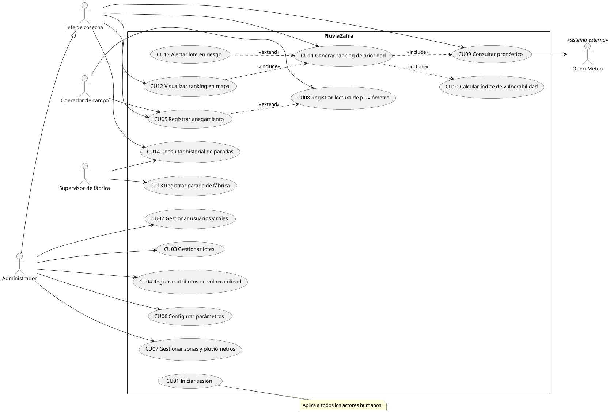

# PluviaZafra: Modelado de casos de uso

Proyecto: Ingenio La Esperanza (nombre provisorio PluviaZafra). Equipo: Carpincho Software.

Las especificaciones detalladas (formato Cockburn) están en [especificaciones-casos-de-uso.md](especificaciones-casos-de-uso.md). Los casos agrupados por usuario están en [casos-de-uso-por-usuario.md](casos-de-uso-por-usuario.md). Los puntos entre corchetes están pendientes de confirmar en la entrevista.

## Actores

- **Jefe de cosecha** (planificador): consulta el ranking y decide el orden de cosecha. Actor principal. [confirmar el cargo real en el ingenio]
- **Operador de campo**: carga lecturas de pluviómetro y reporta anegamientos.
- **Supervisor de fábrica**: registra las paradas con causa y duración.
- **Administrador**: gestiona usuarios, lotes, zonas y parámetros del modelo.
- **Open-Meteo** (actor secundario, sistema externo): provee el pronóstico.

Firebase Auth no es actor, es infraestructura. El inicio de sesión se modela como un único caso de uso, sin `include` desde todos los demás.

## Casos de uso

| Código | Caso de uso | Actor |
|---|---|---|
| CU01 | Iniciar sesión | Todos los humanos |
| CU02 | Gestionar usuarios y roles | Administrador |
| CU03 | Gestionar lotes (polígono, datos y estado) | Administrador |
| CU04 | Registrar atributos de vulnerabilidad del lote | Administrador |
| CU05 | Registrar anegamiento | Operador de campo, Jefe de cosecha |
| CU06 | Configurar parámetros del sistema | Administrador |
| CU07 | Gestionar zonas y pluviómetros | Administrador |
| CU08 | Registrar lectura de pluviómetro | Operador de campo |
| CU09 | Consultar pronóstico | Jefe de cosecha, Open-Meteo |
| CU10 | Calcular índice de vulnerabilidad | (interno) |
| CU11 | Generar ranking de prioridad de cosecha | Jefe de cosecha |
| CU12 | Visualizar ranking en el mapa | Jefe de cosecha |
| CU13 | Registrar parada de fábrica | Supervisor de fábrica |
| CU14 | Consultar historial de paradas | Jefe de cosecha, Supervisor, Administrador |
| CU15 | Alertar lote en riesgo | (extiende CU11) |

## Relaciones

- CU11 `<<include>>` CU10 y CU09. La lluvia acumulada sale de las lecturas de CU08.
- CU12 `<<include>>` CU11.
- CU15 `<<extend>>` CU11, con punto de extensión "lote con semáforo rojo".
- CU05 `<<extend>>` CU08, con la condición "el operador observa un lote intransitable". CU05 también puede ejecutarse solo.
- El Administrador hereda del Jefe de cosecha. [válido si en la entrevista confirman que no hay separación estricta]

Regla práctica: `include` es obligatorio y lo invoca el caso base; `extend` es opcional y el caso base no lo conoce.

## Diagrama (PlantUML)

## Cambios respecto de la primera versión

- CU06 pasó de "pesos y umbrales" a "parámetros del sistema" (incluye semáforo, lluvia crítica y ventanas).
- CU07 pasó de "pluviómetros" a "zonas y pluviómetros", porque cada zona tiene un pluviómetro.
- CU03 incluye polígono dibujado y estados (semáforo y operativos).
- CU15 se dispara con lotes en rojo.

## Pendientes

- Decidir si entra CU16 "Registrar stock de patio" (hoy fuera del alcance, pero la hipótesis del problema depende de ese dato).
- Confirmar con la consigna de la cátedra qué otros diagramas piden y el formato de especificación.
- Confirmar en la entrevista los roles reales y si el Administrador hereda del Jefe de cosecha.
