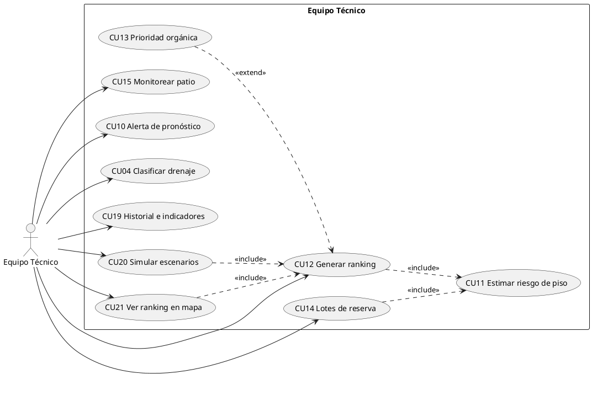
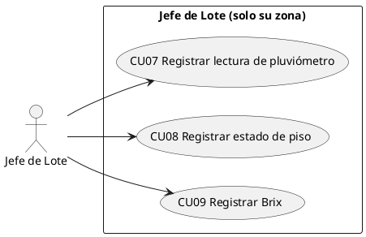
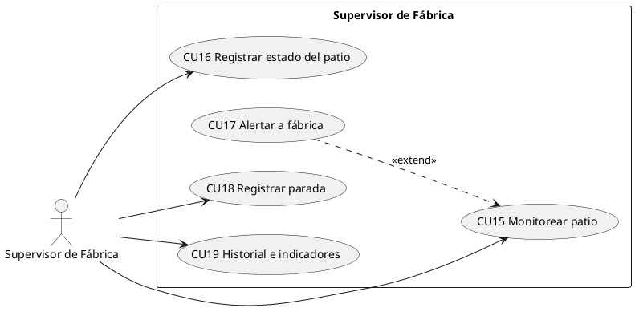
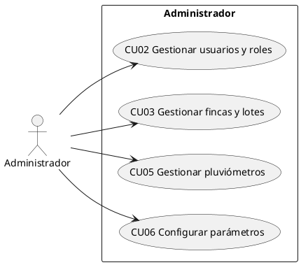

# PluviaZafra: Casos de uso por rol (v2)

Agrupa los casos de [casos-de-uso-v2.md](casos-de-uso-v2.md) por rol y define los accesos. Las especificaciones están en [especificaciones-casos-de-uso-v2.md](especificaciones-casos-de-uso-v2.md). Los valores entre corchetes son propuestas a confirmar.

## 1. Principios de acceso

1. **Mínimo privilegio:** cada rol ve y hace solo lo que necesita para su tarea.
2. **Una cuenta puede tener más de un rol**, por si una persona cumple varias funciones. Los permisos son la unión de los de sus roles. Las cargas de datos se firman igual con la misma cuenta.
3. **Quien carga el dato lo firma:** todo registro guarda autor, fecha y hora. Los registros no se borran: se corrigen conservando el valor anterior.
4. **Alcance por finca:** la zona del Jefe de Lote equivale a su finca. Carga y ve solo los lotes y pluviómetros de su finca.
5. **Lo observado manda:** un estado de piso cargado por el Jefe de Lote prevalece sobre la estimación del sistema.
6. **El sistema recomienda, el Equipo Técnico decide.** Ningún otro rol modifica el ranking.
7. **Separación de funciones:** quien administra el sistema no planifica la cosecha ni carga datos de campo. Así los datos de campo y las decisiones tienen un responsable claro.

## 2. Roles

| Rol | Quiénes son | Dispositivo habitual | Objetivo en el sistema |
|---|---|---|---|
| **Equipo Técnico Agrícola** | Dirección de Agrotecnia, gerente, jefe de cosecha y logística | Computadora (reunión matutina) y celular | Decidir qué lotes se cosechan y anticipar riesgos |
| **Jefe de Lote** | Los 5 jefes de lote | Celular, en el campo | Cargar lluvia, piso y Brix |
| **Supervisor de Fábrica** | Jefe del área industrial y báscula | Computadora en fábrica | Registrar patio y paradas, y recibir alertas |
| **Administrador** | Responsable técnico del sistema | Computadora | Mantener usuarios, inventario y parámetros |

Open-Meteo es un actor externo y no tiene cuenta.

## 3. Matriz de casos de uso por rol

`●` ejecuta el caso. `○` solo consulta. `–` sin acceso.

| Código | Caso de uso | Equipo Técnico | Jefe de Lote | Supervisor de Fábrica | Administrador |
|---|---|:-:|:-:|:-:|:-:|
| CU01 | Iniciar sesión | ● | ● | ● | ● |
| CU02 | Gestionar usuarios y roles | – | – | – | ● |
| CU03 | Gestionar fincas y lotes | ○ | ○ (su zona) | – | ● |
| CU04 | Clasificar drenaje del lote | ● | – | – | ○ |
| CU05 | Gestionar pluviómetros | ○ | ○ (el suyo) | – | ● |
| CU06 | Configurar parámetros | ○ | – | – | ● |
| CU07 | Registrar lectura de pluviómetro | ○ | ● (su zona) | – | – |
| CU08 | Registrar estado de piso | ○ | ● (su zona) | – | – |
| CU09 | Registrar Brix | ○ | ● (su zona) | – | – |
| CU10 | Consultar alerta de pronóstico | ● | – | ○ | – |
| CU11 | Estimar riesgo de piso (interno) | – | – | – | – |
| CU12 | Generar ranking de prioridad | ● | – | ○ | – |
| CU13 | Activar prioridad orgánica | ● | – | – | – |
| CU14 | Gestionar lotes de reserva | ● | – | ○ | – |
| CU15 | Monitorear abastecimiento de patio | ● | – | ● | – |
| CU16 | Registrar estado del patio | ○ | – | ● | – |
| CU17 | Alertar a fábrica | ○ | – | ● (recibe) | – |
| CU18 | Registrar parada de fábrica | ○ | – | ● | – |
| CU19 | Consultar historial e indicadores de paradas | ● | – | ● | ○ |
| CU20 | Simular escenarios | ● | – | – | – |
| CU21 | Visualizar ranking en el mapa | ● | – | ○ | – |

Notas:
- CU11 es interno: lo invocan CU12, CU14 y CU07. Ningún actor lo ejecuta directo.
- CU03: el Administrador es el único que da de alta, modifica o importa lotes. Los demás roles los ven.
- CU04: el Equipo Técnico clasifica el drenaje porque es quien conoce el terreno. El Administrador solo lo consulta.
- CU06: el Administrador cambia los parámetros, pero con acuerdo del Equipo Técnico.

## 4. Permisos sobre los datos

`C` crea, `L` lee, `M` corrige, `–` sin acceso.

| Dato | Equipo Técnico | Jefe de Lote | Supervisor de Fábrica | Administrador |
|---|:-:|:-:|:-:|:-:|
| Usuarios y roles | – | – | – | C L M |
| Fincas y lotes | L | L (su zona) | – | C L M |
| Clase de drenaje | C L M | L (su zona) | – | L |
| Pluviómetros | L | L (el suyo) | – | C L M |
| Lecturas de lluvia | L | C L (su zona) | L | L |
| Estado de piso | L | C L M (su zona) | L | L |
| Lecturas de Brix | L | C L M (su zona) | – | L |
| Pronóstico | L | – | L | – |
| Ranking oficial | C L | – | L | – |
| Ajuste manual del ranking | C L | – | – | – |
| Lotes de reserva | C L M | – | L | – |
| Estado del patio | L | – | C L M | L |
| Paradas de fábrica | L | – | C L M | L |
| Parámetros del sistema | L | – | – | C L M |
| Simulaciones | C L (propias) | – | – | – |
| Auditoría de cambios | L | – | – | L |

Reglas:
- **Corregir:** el Jefe de Lote solo corrige sus propias cargas, y el Supervisor de Fábrica las suyas. La corrección conserva el valor original.
- **Ranking:** el Supervisor de Fábrica ve el ranking y la reserva para anticipar el abastecimiento, pero no los modifica.
- **Simulaciones:** son privadas y transitorias. Nunca reemplazan al ranking oficial.

## 5. Casos de uso por rol

### 5.1 Equipo Técnico Agrícola

Rol decisor. Usa el sistema en la reunión de cada mañana.

| Función | Casos |
|---|---|
| Decidir el orden de cosecha | CU12, CU13 |
| Anticipar lluvia y piso | CU10, CU04 |
| Asegurar abastecimiento | CU14, CU15 |
| Evaluar el impacto y probar escenarios | CU19, CU20 |
| Ver el ranking en el mapa | CU21 |
| Solo consulta | CU03, CU05, CU06, CU07, CU08, CU09, CU16, CU17, CU18 |

**Flujo típico de la mañana:**
1. Ve las lecturas de lluvia, el piso y el Brix cargados por los jefes de lote (consulta).
2. Revisa el monitor de patio (CU15) y la alerta de pronóstico (CU10).
3. Genera el ranking (CU12). Si hay venta de orgánico, activa CU13.
4. Revisa los lotes de reserva (CU14).
5. Si hay duda, simula un escenario (CU20) y decide.

**Restricciones:** no da de alta lotes, usuarios ni pluviómetros, ni carga lluvia, piso, Brix, patio o paradas.

### 5.2 Jefe de Lote

Rol de carga de datos. Solo celular y solo su zona.

| Función | Casos |
|---|---|
| Cargar datos de campo | CU07, CU08, CU09 |
| Solo consulta | CU03, CU05 (limitado a su zona) |

**Flujo típico:**
1. Lee su pluviómetro por la mañana y lo carga (CU07).
2. Recorre sus lotes y marca "se puede entrar" o "no se puede entrar" (CU08).
3. Carga el Brix de los lotes que mide (CU09).

**Restricciones:**
- Ve solo los lotes y el pluviómetro de su zona.
- No ve el ranking, el pronóstico, el patio ni las paradas.
- La interfaz móvil tiene solo tres acciones: lluvia, piso y Brix.

### 5.3 Supervisor de Fábrica

Rol industrial. Registra el patio y las paradas, y recibe alertas.

| Función | Casos |
|---|---|
| Registrar el patio | CU16 |
| Registrar paradas | CU18 |
| Vigilar abastecimiento y recibir alertas | CU15, CU17 |
| Medir el impacto | CU19 |
| Solo consulta | CU10, CU12, CU14, CU21 |

**Flujo típico:**
1. Registra la cantidad de carros en el patio (CU16).
2. Ve la cobertura en horas y las alertas (CU15, CU17).
3. Si la fábrica se detiene, abre la parada y la cierra al reanudar con su causa (CU18).
4. Consulta el historial para medir el impacto (CU19).

**Restricciones:** no modifica el ranking, los lotes ni los datos de campo. Ve el pronóstico, el ranking y la reserva solo para planificar mantenimiento y turnos.

### 5.4 Administrador

Rol de soporte. No decide sobre la cosecha.

| Función | Casos |
|---|---|
| Gestionar accesos | CU02 |
| Mantener el inventario | CU03, CU05 |
| Configurar el modelo | CU06 |
| Solo consulta | CU04, CU19 |

**Flujo típico:**
1. Antes de la zafra, importa el inventario oficial (CU03) y carga los pluviómetros (CU05).
2. Da de alta a los usuarios con su rol (CU02).
3. Ajusta los parámetros acordados con el Equipo Técnico (CU06).

**Restricciones:**
- No genera el ranking ni carga datos de campo o de fábrica.
- No puede deshabilitar al último administrador (CU02).

## 6. Diagramas por rol (PlantUML)

## 7. Decisiones tomadas

- **Varios roles por cuenta:** una persona puede tener más de un rol en la misma cuenta.
- **Zona del Jefe de Lote = finca.** Un jefe ve y carga los lotes de su finca. Como hay 16–17 pluviómetros y 5 fincas, una finca puede tener varios pluviómetros.
- **Estado del patio:** lo carga el Supervisor de Fábrica.
- **Mapa:** CU21 queda en el modelo. Las coordenadas de los lotes serán aproximadas (ver [valores-a-confirmar-v2.md](valores-a-confirmar-v2.md)).

## 8. Pendientes de definición

- **Dirección de Agrotecnia (Grupo):** todavía no se sabe si necesita un rol aparte de solo lectura con tablero. Mientras tanto queda dentro del Equipo Técnico.
- **Auditoría:** confirmar si el Equipo Técnico puede ver quién cargó cada dato (propuesto que sí).
- **Pluviómetro de cada lote:** definir cómo se asigna el pluviómetro a cada lote dentro de su finca.

Lista consolidada: [valores-a-confirmar-v2.md](valores-a-confirmar-v2.md).
