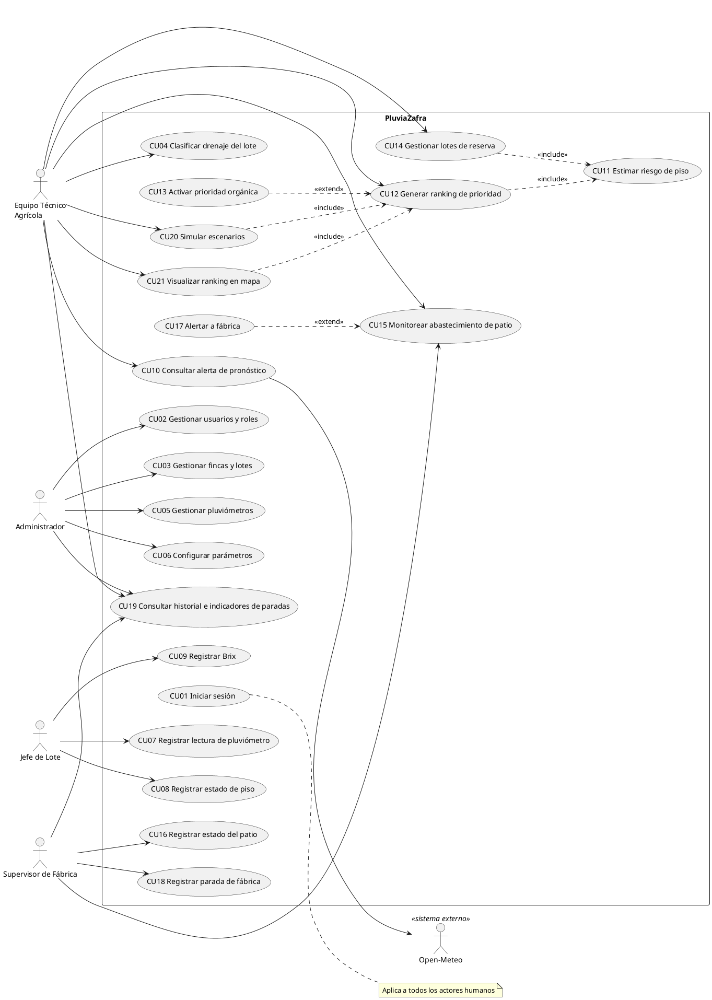

# PluviaZafra: Modelo de casos de uso (v2, con datos reales)

Proyecto: Ingenio La Esperanza (ILE). Versión basada en la entrevista del 19/11/2026 y el inventario `ZAFRA 2025`.
Las especificaciones (formato Cockburn) están en [especificaciones-casos-de-uso-v2.md](especificaciones-casos-de-uso-v2.md).
Los modelos de dominio y reglas de cálculo están en [modelado-v2-datos-reales.md](modelado-v2-datos-reales.md).

## Objetivo del sistema

Sistema de apoyo a la decisión que **prioriza los lotes a cosechar para sostener la llegada continua de caña al ingenio** durante la zafra (7.000–7.500 t/día, 312,5 t/h). No reemplaza al jefe de cosecha: le entrega cada día una lista de lotes priorizados y alertas.

## Actores

| Actor | Rol real en el ingenio | Qué hace en el sistema |
|---|---|---|
| **Equipo Técnico Agrícola** (actor principal) | Dirección de Agrotecnia, gerente y jefe de cosecha/logística (en 2026, Javier Tapia) | Planifica: consulta el ranking, lotes de reserva, riesgo de piso y abastecimiento. Decide el orden real. |
| **Jefe de Lote** | 5 jefes de lote, uno por área, con pluviómetro manual | Carga cada mañana lluvia, estado del piso y Brix, desde el celular. |
| **Supervisor de Fábrica** | Área industrial (Pedro) y báscula | Registra paradas y el estado del patio (carros). |
| **Administrador** | Soporte del sistema | Gestiona usuarios, fincas, lotes, pluviómetros y parámetros. |
| **Open-Meteo** (secundario, externo) | Servicio de pronóstico | Provee el pronóstico, usado solo como alerta. |

Notas de modelado:
- Los **operarios, maquinistas y camioneros no son actores**: no usan el sistema (confirmado en la entrevista).
- **Una cuenta puede tener más de un rol** (por si una persona cumple varias funciones). Sus permisos son la unión de los de sus roles.
- Firebase Auth es infraestructura, no actor. El inicio de sesión es un único caso de uso.
- **Cambio respecto de v1:** desaparece el "Operador de campo" y aparece el "Jefe de Lote". El "Jefe de cosecha" pasa a ser parte del Equipo Técnico. No se asume que el Administrador herede del Equipo Técnico.

## Casos de uso

| Código | Caso de uso | Actor | Origen en la entrevista |
|---|---|---|---|
| CU01 | Iniciar sesión | Todos los humanos | Dos roles de carga y planificación |
| CU02 | Gestionar usuarios y roles | Administrador | Roles reales |
| CU03 | Gestionar fincas y lotes | Administrador | Inventario oficial 2025 (223 lotes) |
| CU04 | Clasificar drenaje del lote | Equipo Técnico | "El drenaje es lo fundamental" |
| CU05 | Gestionar pluviómetros | Administrador | 16–17 manuales y fijos |
| CU06 | Configurar parámetros del sistema | Administrador | Brix mínimo, pesos, umbrales de patio |
| CU07 | Registrar lectura de pluviómetro | Jefe de Lote | Lectura diaria hoy enviada por celular |
| CU08 | Registrar estado de piso | Jefe de Lote | Transitable / no transitable |
| CU09 | Registrar Brix | Jefe de Lote | Madurez como filtro de habilitación |
| CU10 | Consultar alerta de pronóstico | Equipo Técnico, Open-Meteo | Pronóstico solo como alerta |
| CU11 | Estimar riesgo de piso | (interno) | Lluvia acumulada × drenaje |
| CU12 | Generar ranking de prioridad de cosecha | Equipo Técnico | Distancia, variedad, soca, orgánico |
| CU13 | Activar prioridad orgánica | Equipo Técnico | Venta imprevista de orgánico |
| CU14 | Gestionar lotes de reserva | Equipo Técnico | Lotes maduros y bien drenados para días de lluvia |
| CU15 | Monitorear abastecimiento de patio | Equipo Técnico, Supervisor de Fábrica | Cobertura de 2–3 h |
| CU16 | Registrar estado del patio | Supervisor de Fábrica | Carros en patio |
| CU17 | Alertar a fábrica | (extiende CU15) | Aviso anticipado para mantenimiento |
| CU18 | Registrar parada de fábrica | Supervisor de Fábrica | Causa y duración |
| CU19 | Consultar historial e indicadores de paradas | Equipo Técnico, Supervisor de Fábrica, Administrador | Horas de parada, toneladas sin cosechar |
| CU20 | Simular escenarios | Equipo Técnico | "Entra una venta de orgánico", "llovieron X mm" |
| CU21 | Visualizar ranking en el mapa | Equipo Técnico | Tablero para la reunión de cada mañana |

## Relaciones

- CU12 `<<include>>` CU11. El ranking usa el riesgo de piso de cada lote. El Brix mínimo y el piso actúan como filtro de habilitación antes de rankear.
- CU14 `<<include>>` CU11. Los lotes de reserva se eligen entre los maduros y bien drenados.
- CU20 `<<include>>` CU12. La simulación recalcula el ranking sin persistirlo.
- CU21 `<<include>>` CU12. El mapa muestra el ranking vigente (u oficial) con la posición aproximada de cada lote.
- CU13 `<<extend>>` CU12, con la condición "hay una venta de orgánico".
- CU17 `<<extend>>` CU15, con la condición "cobertura menor al umbral o parada probable".
- CU07, CU08 y CU09 son independientes: se cargan juntos cada mañana, pero no dependen unos de otros.

Regla práctica: `include` es obligatorio y lo invoca el caso base. `extend` es opcional y el caso base no lo conoce.

## Diagrama (PlantUML)

## Cambios respecto de la v1

| v1 | v2 | Motivo |
|---|---|---|
| CU04 Atributos de vulnerabilidad (suelo, camino) | CU04 Clasificar drenaje | Los caminos son buenos. El problema es el piso. |
| CU05 Registrar anegamiento | CU08 Registrar estado de piso | Se registra a diario, no solo el evento. |
| (no existía) | CU09 Registrar Brix | La madurez habilita o no el corte. |
| CU10 Calcular índice de vulnerabilidad | CU11 Estimar riesgo de piso | Lluvia acumulada × drenaje, con días hasta ser transitable. |
| CU09 Consultar pronóstico (decide) | CU10 Alerta de pronóstico | Poco confiable a escala local. Solo sirve para prepararse. |
| CU11 Ranking por vulnerabilidad | CU12 Ranking de prioridad | Suma distancia, variedad, soca y tipo de cultivo. |
| (no existía) | CU13 Prioridad orgánica | Las ventas de exportación interrumpen el plan. |
| (no existía) | CU14 Lotes de reserva | Aporte central para evitar paradas. |
| CU17 pendiente (stock de patio) | CU15, CU16 y CU17 | Pedro dio el umbral: 2–3 h o 15–20 carros. |
| CU12 Mapa | CU21 Visualizar ranking en el mapa | Se mantiene. Las coordenadas de los lotes serán aproximadas (ver pendientes). |
| CU16 Simular precipitaciones | CU20 Simular escenarios | Ahora incluye "entra una venta de orgánico". |

## Pendientes

Resueltos:
- **Mapa:** se mantiene (CU21). El inventario no trae coordenadas exactas. Se ubicarán los lotes de forma aproximada a partir de las coordenadas del ingenio y de `DIST ILE`. Se resuelve en la implementación, directamente en el mapa.
- **Quién carga el estado del patio:** confirmado, el Supervisor de Fábrica.
- **Roles por usuario:** una cuenta puede tener más de un rol.
- **Zona del Jefe de Lote:** equivale a la finca.

Pendientes: ver la lista consolidada en [valores-a-confirmar-v2.md](valores-a-confirmar-v2.md).
