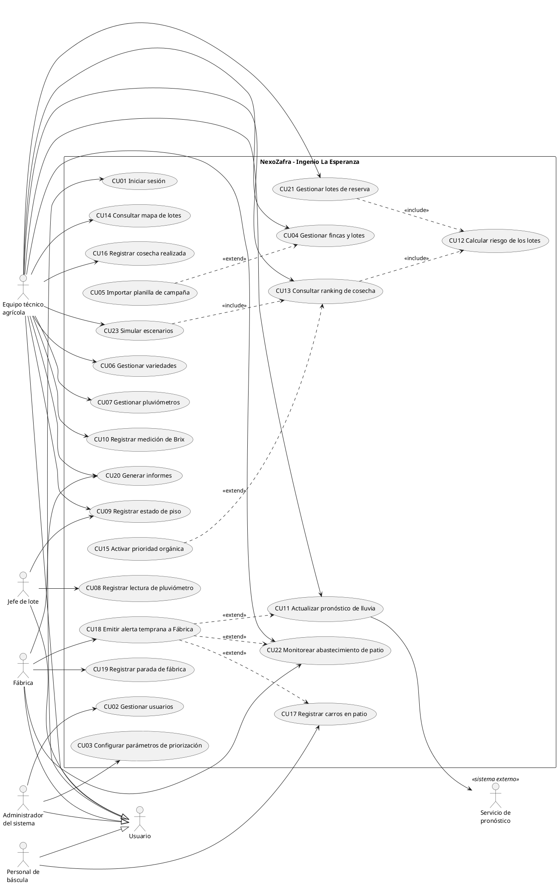

# NexoZafra: Modelo de casos de uso unificado (v2)

Proyecto: Sistema de priorización de cosecha – Ingenio La Esperanza (ILE).
Unifica la propuesta de **@Jairo** (`CU01`–`CU20` y 5 actores humanos) con los casos adicionales y los parámetros confirmados de nuestro relevamiento (`CU21`–`CU23`).

- Especificaciones detalladas: [especificaciones-casos-de-uso-v2.md](especificaciones-casos-de-uso-v2.md)
- Casos de uso y permisos por rol: [casos-de-uso-por-rol-v2.md](casos-de-uso-por-rol-v2.md)
- Parámetros confirmados y pendientes: [valores-a-confirmar-v2.md](valores-a-confirmar-v2.md)

## 1. Objetivo del sistema

Sistema de apoyo a la decisión que **prioriza los lotes a cosechar para sostener la llegada continua de caña al ingenio** durante la zafra (7.000–7.500 t/día, 312,5 t/h). No reemplaza al Equipo técnico agrícola: le entrega cada día una lista de lotes priorizados, lotes de reserva y alertas tempranas.

## 2. Actores

El sistema tiene **cinco actores humanos** (que heredan de un actor abstracto **Usuario**, quien inicia sesión) y **un actor externo**:

| Actor | Tipo | Quién es en el ingenio | Qué hace en el sistema |
|---|---|---|---|
| **Usuario** *(abstracto)* | Abstracto | Cualquier usuario con cuenta activa | Inicia y cierra sesión (`CU01`). Una cuenta puede tener asignado más de un rol. |
| **Equipo técnico agrícola (Agrotecnia)** | Principal | Gerente agrícola, responsable de logística de cosecha (Javier Tapia en 2026) y técnicos del área | Mantiene fincas, lotes (incluido el tipo de drenaje), variedades y pluviómetros; importa la planilla de campaña; registra Brix y estado de piso; consulta el ranking y el mapa; activa la prioridad orgánica; gestiona lotes de reserva; monitorea el patio; simula escenarios; registra la cosecha realizada; carga o corrige el pronóstico; genera informes. |
| **Jefe de lote** | Principal | Los 5 jefes de lote que recorren el campo | Carga desde el celular la lectura diaria de los pluviómetros y el estado de piso de los lotes de su finca. |
| **Fábrica** | Principal | Jefe de área de fábrica (Pedro) | Recibe la alerta temprana, monitorea el abastecimiento de patio, registra las paradas de fábrica y consulta informes. |
| **Personal de báscula** | Principal | Personal que recibe y coordina el ingreso de camiones | Registra la cantidad de carros en patio (colchón de caña). |
| **Administrador del sistema** | Principal | Persona de sistemas designada por el ingenio | Gestiona usuarios y roles; configura los parámetros de priorización (umbral de Brix, km de cada zona, carros/horas de colchón para alertar, umbral de probabilidad de lluvia). |
| **Servicio de pronóstico** | Secundario (sistema externo) | API meteorológica gratuita (Open-Meteo) | Entrega al sistema el pronóstico de lluvia por ubicación de cada finca. |

Notas de modelado:
- **El jefe de cosecha también registra estado de piso**, porque va en persona a verificar si hay piso antes de mover máquinas.
- **El tipo de drenaje del lote** se gestiona dentro de la ficha del lote en `CU04 – Gestionar fincas y lotes`.
- **Los operarios, maquinistas y camioneros no son actores** del sistema.

## 3. Catálogo unificado de casos de uso (`CU01` a `CU23`)

Se mantienen los **20 casos de uso de Jairo con su numeración exacta (`CU01`–`CU20`)** y se suman al final los **3 casos nuestros (`CU21`–`CU23`)**.
Etiquetas de origen: `[TCI]` = alcance funcional del informe, `[Entrevista]` = ajuste surgido de la entrevista, `[Sugerencia]` = propuesta del equipo.

| Código | Caso de uso | Origen | Actor(es) principal(es) |
|---|---|---|---|
| **CU01** | Iniciar sesión | `[TCI]` | Usuario (todos los actores humanos) |
| **CU02** | Gestionar usuarios | `[Sugerencia]` | Administrador del sistema |
| **CU03** | Configurar parámetros de priorización | `[Entrevista]` | Administrador del sistema |
| **CU04** | Gestionar fincas y lotes *(incluye drenaje y pluviómetro de referencia)* | `[TCI]` | Equipo técnico agrícola |
| **CU05** | Importar planilla de campaña | `[Sugerencia]` | Equipo técnico agrícola |
| **CU06** | Gestionar variedades | `[Entrevista]` | Equipo técnico agrícola |
| **CU07** | Gestionar pluviómetros | `[Sugerencia]` | Equipo técnico agrícola |
| **CU08** | Registrar lectura de pluviómetro | `[TCI]` | Jefe de lote |
| **CU09** | Registrar estado de piso | `[TCI]` | Jefe de lote, Equipo técnico agrícola |
| **CU10** | Registrar medición de Brix | `[Entrevista]` | Equipo técnico agrícola |
| **CU11** | Actualizar pronóstico de lluvia | `[TCI]` | Servicio de pronóstico (automático), Equipo técnico agrícola (manual) |
| **CU12** | Calcular riesgo de los lotes | `[TCI]` | *(Interno del sistema)* |
| **CU13** | Consultar ranking de cosecha | `[TCI]` | Equipo técnico agrícola |
| **CU14** | Consultar mapa de lotes | `[TCI]` | Equipo técnico agrícola |
| **CU15** | Activar prioridad orgánica | `[Entrevista]` | Equipo técnico agrícola |
| **CU16** | Registrar cosecha realizada | `[Sugerencia]` | Equipo técnico agrícola |
| **CU17** | Registrar carros en patio | `[Entrevista]` | Personal de báscula |
| **CU18** | Emitir alerta temprana a Fábrica | `[Entrevista]` | *(Sistema)* / Fábrica (receptor) |
| **CU19** | Registrar parada de fábrica | `[TCI]` | Fábrica |
| **CU20** | Generar informes | `[TCI]` | Equipo técnico agrícola, Fábrica |
| **CU21** | Gestionar lotes de reserva *(agregado nuestro)* | `[Entrevista]` | Equipo técnico agrícola |
| **CU22** | Monitorear abastecimiento de patio *(agregado nuestro)* | `[Entrevista]` | Equipo técnico agrícola, Fábrica |
| **CU23** | Simular escenarios *(agregado nuestro)* | `[Sugerencia]` | Equipo técnico agrícola |

## 4. Relaciones entre casos de uso

- **Herencia de actores:** `Equipo técnico agrícola`, `Jefe de lote`, `Fábrica`, `Personal de báscula` y `Administrador del sistema` heredan del actor abstracto `Usuario` (`CU01`).
- **Inclusiones (`<<include>>`):**
  - `CU13 Consultar ranking de cosecha` `<<include>>` `CU12 Calcular riesgo de los lotes`.
  - `CU21 Gestionar lotes de reserva` `<<include>>` `CU12 Calcular riesgo de los lotes`.
  - `CU23 Simular escenarios` `<<include>>` `CU13 Consultar ranking de cosecha` (recalcula en memoria sin persistir).
  - `CU08`, `CU09` y `CU11` disparan la actualización de `CU12 Calcular riesgo de los lotes`.
- **Extensiones (`<<extend>>`):**
  - `CU05 Importar planilla de campaña` `<<extend>>` `CU04 Gestionar fincas y lotes`.
  - `CU15 Activar prioridad orgánica` `<<extend>>` `CU13 Consultar ranking de cosecha` (cuando entra un pedido de azúcar orgánica).
  - `CU18 Emitir alerta temprana a Fábrica` `<<extend>>` `CU11 Actualizar pronóstico de lluvia` (cuando la probabilidad ≥ 70 % en una finca con cosecha en curso) y `<<extend>>` `CU17 Registrar carros en patio` / `CU22 Monitorear abastecimiento de patio` (cuando el colchón baja del mínimo).

## 5. Diagrama de casos de uso unificado (PlantUML)

