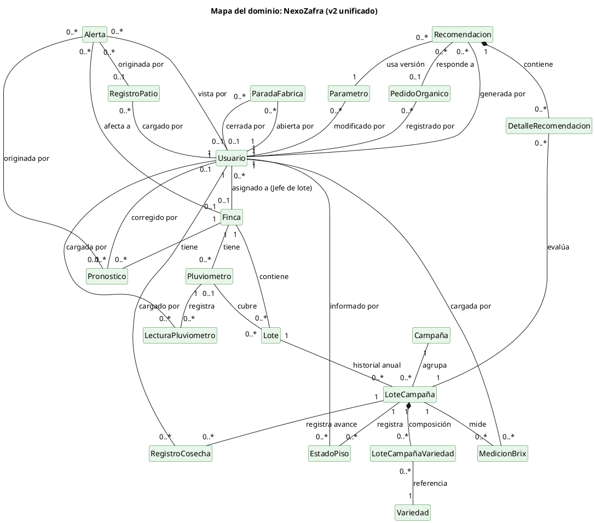

# NexoZafra: Diagrama de clases completo y Mapa del dominio (v2 unificado)

Reúne los 23 diagramas por caso de uso de [diagramas-clases-por-cu-v2.md](diagramas-clases-por-cu-v2.md) en un único modelo BCE (Boundary–Control–Entity), alineado con las [especificaciones de casos de uso](especificaciones-casos-de-uso-v2.md) y el DER de [solucion-tecnologica-unificada.md](solucion-tecnologica-unificada.md).

Contiene tres secciones principales:
1. **Diagrama completo (BCE):** actores, interfaces, gestores, entidades y servicio externo con sus relaciones.
2. **Mapa del dominio:** solo las entidades del dominio con sus asociaciones y multiplicidades (base para Firestore y el modelo relacional).
3. **Diccionario de enumerados:** los 16 enumerados del sistema y su correspondencia con las tablas catálogo del DER.

---

## Resumen de componentes

| Capa | Cantidad | Clases |
|---|---|---|
| **Actores** | 6 *(1 abstracto + 5 humanos)* | `Usuario` *(abstracto)*, `Equipo técnico agrícola`, `Jefe de lote`, `Fábrica`, `Personal de báscula`, `Administrador del sistema` |
| **Interfaces** | 22 | `InterfazLogin`, `InterfazUsuarios`, `InterfazParametros`, `InterfazLotes`, `InterfazImportacion`, `InterfazVariedades`, `InterfazPluviometros`, `InterfazLecturaPluviometro`, `InterfazEstadoPiso`, `InterfazMedicionBrix`, `InterfazPronostico`, `InterfazRanking`, `InterfazMapa`, `InterfazPedidoOrganico`, `InterfazCosecha`, `InterfazRegistroPatio`, `InterfazAlertas`, `InterfazParadas`, `InterfazInformes`, `InterfazLotesReserva`, `InterfazMonitorPatio`, `InterfazSimulador` |
| **Gestores** | 22 | `GestorSesion`, `GestorUsuarios`, `GestorParametros`, `GestorLotes`, `GestorImportacion`, `GestorVariedades`, `GestorPluviometros`, `GestorLecturas`, `GestorEstadoPiso`, `GestorBrix`, `GestorPronostico`, `GestorRiesgo`, `GestorRanking`, `GestorMapa`, `GestorPedidoOrganico`, `GestorCosecha`, `GestorPatio`, `GestorAlertas`, `GestorParadas`, `GestorInformes`, `GestorReserva`, `GestorSimulador` |
| **Entidades** | 20 | `Usuario`, `Finca`, `Lote`, `Campaña`, `Variedad`, `LoteCampaña`, `LoteCampañaVariedad`, `Pluviometro`, `LecturaPluviometro`, `EstadoPiso`, `MedicionBrix`, `Pronostico`, `Parametro`, `Recomendacion`, `DetalleRecomendacion`, `PedidoOrganico`, `RegistroCosecha`, `RegistroPatio`, `Alerta`, `ParadaFabrica` |
| **Externo** | 1 | `ServicioOpenMeteo` |
| **Enumerados** | 16 | `Rol`, `ZonaDistancia`, `TipoDrenaje`, `EpocaMaduracion`, `TipoCultivo`, `CertificacionOrganica`, `EstadoLote`, `CondicionPiso`, `OrigenBrix`, `FuentePronostico`, `NivelRiesgo`, `EstadoPedidoOrganico`, `TipoAlerta`, `NivelAlerta`, `CausaParada`, `TipoInforme` |

*(Nota: `CU12 – Calcular riesgo de los lotes` es interno, por eso existen 22 interfaces para 23 casos de uso).*

---

## 1. Diagrama completo (BCE)

```plantuml
@startuml
title Diagrama de clases completo: NexoZafra (v2 unificado)
skinparam classAttributeIconSize 0
skinparam shadowing false
hide circle
skinparam class {
  BackgroundColor<<interfaz>> #E3F2FD
  BorderColor<<interfaz>> #1565C0
  BackgroundColor<<gestor>> #FFF3E0
  BorderColor<<gestor>> #EF6C00
  BackgroundColor<<entidad>> #E8F5E9
  BorderColor<<entidad>> #2E7D32
  BackgroundColor<<externo>> #F3E5F5
  BorderColor<<externo>> #6A1B9A
  BackgroundColor<<actor>> #FFFDE7
  BorderColor<<actor>> #F9A825
}

' ---------- Actores ----------
abstract class "Usuario (Actor)" as ACT_USR <<actor>>
class "Equipo técnico agrícola" as ET <<actor>>
class "Jefe de lote" as JL <<actor>>
class "Fábrica" as FAB <<actor>>
class "Personal de báscula" as BAS <<actor>>
class "Administrador del sistema" as ADM <<actor>>

ET --|> ACT_USR
JL --|> ACT_USR
FAB --|> ACT_USR
BAS --|> ACT_USR
ADM --|> ACT_USR

' ---------- Interfaces ----------
package "Interfaces (Boundary)" {
  class InterfazLogin <<interfaz>> {
    +mostrarFormulario()
    +enviarCredenciales(correo, clave)
    +mostrarError(mensaje)
    +redirigirSegunRoles(roles)
  }
  class InterfazUsuarios <<interfaz>> {
    +listarUsuarios(usuarios)
    +cargarDatosUsuario(nombre, apellido, correo, roles, idFinca)
    +actualizarRoles(idUsuario, roles)
    +desactivarUsuario(idUsuario)
  }
  class InterfazParametros <<interfaz>> {
    +mostrarParametrosActuales(p)
    +editarUmbrales(brixMin, kmCercana, kmMedia, probLluvia)
    +editarPatioYMolienda(moliendaTH, carrosMin, cargaBruta, mermaMin, mermaMax)
    +confirmarCambios()
  }
  class InterfazLotes <<interfaz>> {
    +mostrarListado(lotes)
    +filtrar(idFinca, tipo, zona, drenaje)
    +abrirFichaLote(idUnico)
    +editarDatosCampaniaYDrenaje(drenaje, idPluviometro, estado)
    +guardarLote()
  }
  class InterfazImportacion <<interfaz>> {
    +seleccionarCampania(idCampania)
    +subirArchivoExcel(archivo)
    +mostrarResumenValidacion(nuevos, cambios, errores)
    +confirmarImportacion()
  }
  class InterfazVariedades <<interfaz>> {
    +listarVariedades(variedades)
    +cargarVariedad(codigo, epoca)
    +desactivarVariedad(idVariedad)
  }
  class InterfazPluviometros <<interfaz>> {
    +listarPluviometros(pluviometros)
    +cargarDatos(codigo, nombre, idFinca, lat, lon)
    +asignarLotes(idPluviometro, idsLotes)
  }
  class InterfazLecturaPluviometro <<interfaz>> {
    +mostrarPluviometrosDeFinca(pluviometros)
    +ingresarMilimetros(mm)
    +confirmarCorreccion(anterior, nuevo)
    +mostrarEstadoOfflinePendiente()
  }
  class InterfazEstadoPiso <<interfaz>> {
    +buscarLote(idFinca, nombre)
    +seleccionarCondicion(condicion, observacion, maquinaHundida)
    +mostrarHistorialInhabilitacion(periodos)
  }
  class InterfazMedicionBrix <<interfaz>> {
    +seleccionarLote(idUnico)
    +cargarMedicion(fecha, brix, origen)
    +mostrarResultadoHabilitacion(habilitado, categoria)
  }
  class InterfazPronostico <<interfaz>> {
    +mostrarPronosticoPorFinca(pronosticos)
    +cargarCorreccionManual(idFinca, fecha, probPct, mm)
    +mostrarUltimaActualizacion(fechaHora, desactualizado)
  }
  class InterfazRanking <<interfaz>> {
    +solicitarRankingDelDia(esSimulacion)
    +mostrarRanking(rec)
    +mostrarExcluidos(excluidos)
    +guardarRecomendacion()
    +exportarRanking()
  }
  class InterfazMapa <<interfaz>> {
    +renderizarMapa(fincas, lotes)
    +seleccionarCapa(capa)
    +filtrar(idFinca, zona, tipo)
    +mostrarFichaEmergente(idUnico)
  }
  class InterfazPedidoOrganico <<interfaz>> {
    +registrarPedido(fecha, toneladasReq, fechaLimite)
    +cerrarPedido(idPedido, estado)
    +mostrarRankingModoOrganico(rec)
  }
  class InterfazCosecha <<interfaz>> {
    +buscarLote(idUnico)
    +cargarAvanceCosecha(fecha, toneladas, terminado, obs)
  }
  class InterfazRegistroPatio <<interfaz>> {
    +ingresarCarrosYMerma(cantidadCarros, mermaPct, fechaHora)
    +mostrarCoberturaCalculada(horasMinimas, toneladasNetas)
  }
  class InterfazAlertas <<interfaz>> {
    +mostrarAlertasActivas(alertas)
    +marcarComoVista(idAlerta)
  }
  class InterfazParadas <<interfaz>> {
    +abrirParada(inicio, causa, obs)
    +cerrarParada(idParada, fin, costoMateriales)
    +mostrarAdvertenciaReinicio(actuales, requeridos)
  }
  class InterfazInformes <<interfaz>> {
    +seleccionarTipoInforme(tipo)
    +aplicarFiltros(desde, hasta, idCampania, idFinca, zona, cultivo)
    +exportarExcel()
    +exportarPDF()
  }
  class InterfazLotesReserva <<interfaz>> {
    +mostrarPropuestaReserva(lotes, tonTotales, horasCobertura)
    +mostrarSugerenciaAdelantoMalDrenados(lotes)
    +confirmarReserva(idsLotes)
  }
  class InterfazMonitorPatio <<interfaz>> {
    +mostrarTableroAbastecimiento(resumen)
    +mostrarProgresoReinicio(actuales, objetivo)
  }
  class InterfazSimulador <<interfaz>> {
    +activarModoSimulacion()
    +ajustarLluviaSimulada(idFinca, mm)
    +alternarPedidoOrganicoSimulado(activo, toneladas)
    +mostrarComparativaOficialVsSimulado(oficial, simulado)
    +restablecerDatosReales()
  }
}

' ---------- Gestores ----------
package "Gestores (Control)" {
  class GestorSesion <<gestor>> {
    +iniciarSesion(correo, clave): Usuario
    +cerrarSesion()
  }
  class GestorUsuarios <<gestor>> {
    +crearUsuario(nombre, apellido, correo, roles, idFinca): Usuario
    +modificarRoles(idUsuario, roles)
    +desactivar(idUsuario)
  }
  class GestorParametros <<gestor>> {
    +obtenerVigente(): Parametro
    +guardarNuevaVersion(datos, idUsuario): Parametro
  }
  class GestorLotes <<gestor>> {
    +listarLotes(filtros): List<Lote>
    +crearOActualizarLote(lote, camp): Lote
    +clasificarZonaDistancia(distKm, p): ZonaDistancia
  }
  class GestorImportacion <<gestor>> {
    +preprocesarFilas(archivo, idCampania): ResumenImportacion
    +ejecutarImportacion(resumen)
  }
  class GestorVariedades <<gestor>> {
    +guardarVariedad(codigo, epoca): Variedad
    +desactivar(idVariedad)
  }
  class GestorPluviometros <<gestor>> {
    +guardarPluviometro(datos): Pluviometro
    +asociarLotes(idPluviometro, idsLotes)
  }
  class GestorLecturas <<gestor>> {
    +registrarLectura(idPluv, fecha, mm, idUsr): LecturaPluviometro
    +obtenerAcumuladoVentana(idPluv, dias): Real
  }
  class GestorEstadoPiso <<gestor>> {
    +registrarEstadoPiso(idLC, condicion, obs, hundida, idUsr): EstadoPiso
    +cerrarPeriodoInhabilitacion(periodo, fechaFin): Integer
  }
  class GestorBrix <<gestor>> {
    +registrarMedicion(idLC, fecha, valor, origen, idUsr): MedicionBrix
    +evaluarHabilitacionMadurez(valor, param): Boolean
  }
  class GestorPronostico <<gestor>> {
    +actualizarDesdeApiTodasLasFincas()
    +registrarPronosticoManual(idFinca, fecha, prob, mm, idUsr): Pronostico
  }
  class GestorRiesgo <<gestor>> {
    +calcularRiesgoLote(lc): NivelRiesgo
    +estimarDiasSinAcceso(drenaje, lluviaMm, param): Integer
  }
  class GestorRanking <<gestor>> {
    +generarRanking(idCampania, idUsuario, esSimulacion): Recomendacion
    +recalcularConPrioridadOrganica(pedido): Recomendacion
  }
  class GestorMapa <<gestor>> {
    +obtenerDatosGeograficosConEstado(filtros): List<LoteMapaDto>
    +obtenerCoordenadaAproximada(lote, finca): Punto
  }
  class GestorPedidoOrganico <<gestor>> {
    +crearPedidoYActivarModo(fecha, ton, limite, idUsr): PedidoOrganico
    +cerrarPedido(idPedido, estadoFinal)
  }
  class GestorCosecha <<gestor>> {
    +registrarAvance(idLC, fecha, ton, terminado, idUsr): RegistroCosecha
    +obtenerLotesEnCosechaActiva(): List<LoteCampaña>
  }
  class GestorPatio <<gestor>> {
    +registrarCarros(carros, mermaPct, fechaHora, idUsr): RegistroPatio
    +obtenerResumenAbastecimiento(): ResumenPatioDto
  }
  class GestorAlertas <<gestor>> {
    +evaluarAlertaPronostico(pron)
    +evaluarAlertaColchonPatio(patio)
    +marcarVista(idAlerta, idUsr)
  }
  class GestorParadas <<gestor>> {
    +abrirParada(inicio, causa, obs, idUsr): ParadaFabrica
    +cerrarParada(idParada, fin, costoMat, idUsr): ParadaFabrica
    +calcularRangoCostoParada(duracionH, costoMat, p): RangoCosto
  }
  class GestorInformes <<gestor>> {
    +generarInforme(tipo, filtros): InformeDto
    +exportarAExcel(datos): File
    +exportarAPDF(datos): File
  }
  class GestorReserva <<gestor>> {
    +proponerLotesReserva(idCampania): List<LoteCampaña>
    +identificarMalDrenadosAAdelantar(idCampania): List<LoteCampaña>
  }
  class GestorSimulador <<gestor>> {
    +ejecutarSimulacion(escenario): ResultadoSimulacionDto
    +descartarSimulacion()
  }
}

' ---------- Externo ----------
class ServicioOpenMeteo <<externo>> {
  +obtenerPronosticoPorCoordenadas(lat, lon, dias): List<DatosPronosticoDto>
}

' ---------- Entidades ----------
package "Entidades (Entity)" {
  class Usuario <<entidad>> {
    -idUsuario: String
    -nombre: String
    -apellido: String
    -correo: String
    -roles: List<Rol>
    -activo: Boolean
  }
  class Finca <<entidad>> {
    -idFinca: String
    -nombre: String
    -latitud: Real
    -longitud: Real
    -cruzaRuta34: Boolean
    -criticaDrenaje: Boolean
    -activa: Boolean
  }
  class Lote <<entidad>> {
    -idUnico: String
    -nroLote: String
    -nombre: String
    -tipoCultivo: TipoCultivo
    -certificacion: CertificacionOrganica
    -idOia: String
    -areaBrutaHa: Real
    -areaNetaHa: Real
    -surcos: Integer
    -distSurcoM: Real
    -distIngenioKm: Real
    -zonaDistancia: ZonaDistancia
    -tipoDrenaje: TipoDrenaje
    -geometria: Poligono
    -datosIncompletos: Boolean
  }
  class "Campaña" as Campania <<entidad>> {
    -idCampania: String
    -anio: Integer
    -fechaInicio: Date
    -fechaFinEstimada: Date
    -activa: Boolean
  }
  class Variedad <<entidad>> {
    -idVariedad: String
    -codigo: String
    -epocaMaduracion: EpocaMaduracion
    -activa: Boolean
  }
  class "LoteCampaña" as LoteCampania <<entidad>> {
    -idLoteCampania: String
    -anioPlantacion: Integer
    -cantidadCortes: Integer
    -estadoLote: EstadoLote
    -esReserva: Boolean
    -rindeEstimadoTHa: Real
    -nivelRiesgoActual: NivelRiesgo
    -diasSinPisoEstimados: Integer
    +/toneladasEstimadas: Real
  }
  class "LoteCampañaVariedad" as LoteCampaniaVariedad <<entidad>> {
    -superficieHa: Real
    -porcentaje: Real
  }
  class Pluviometro <<entidad>> {
    -idPluviometro: String
    -codigo: String
    -nombre: String
    -ubicacionDesc: String
    -latitud: Real
    -longitud: Real
    -activo: Boolean
  }
  class LecturaPluviometro <<entidad>> {
    -idLectura: String
    -fecha: Date
    -milimetros: Real
    -fechaHoraCarga: DateTime
    -sincronizadaOffline: Boolean
    -corregida: Boolean
    -valorAnteriorMm: Real
  }
  class EstadoPiso <<entidad>> {
    -idEstadoPiso: String
    -condicion: CondicionPiso
    -fechaInicio: DateTime
    -fechaFin: DateTime
    -observacion: String
    -maquinaHundida: Boolean
    +/diasInhabilitado: Integer
  }
  class MedicionBrix <<entidad>> {
    -idMedicion: String
    -fecha: Date
    -valorBrix: Real
    -origen: OrigenBrix
    -categoriaMadurez: EpocaMaduracion
    -habilitadoMadurez: Boolean
  }
  class Pronostico <<entidad>> {
    -idPronostico: String
    -fechaPronosticada: Date
    -probabilidadLluviaPct: Real
    -milimetrosPrevistos: Real
    -fuente: FuentePronostico
    -fechaHoraActualizacion: DateTime
  }
  class Parametro <<entidad>> {
    -idParametro: String
    -version: Integer
    -fechaCambio: DateTime
    -brixMinimo: Real
    -kmLimiteCercanaMax: Real
    -kmLimiteMediaMax: Real
    -moliendaTHora: Real
    -cargaBrutaCarroT: Real
    -mermaNoCaniaMinPct: Real
    -mermaNoCaniaMaxPct: Real
    -carrosMinimosReinicio: Integer
    -horasColchonMinimo: Real
    -probabilidadAlertaLluviaPct: Real
    -ventanaLluviaDias: Integer
    -tablaEsperaDrenaje: Map<TipoDrenaje, ReglaEspera>
    -pesosRanking: Map<String, Real>
    -costoHoraParadaBajoUsd: Real
    -costoHoraParadaCentralUsd: Real
    -costoHoraParadaAltoUsd: Real
  }
  class Recomendacion <<entidad>> {
    -idRecomendacion: String
    -fechaHoraGeneracion: DateTime
    -esModoOrganico: Boolean
    -esSimulacion: Boolean
    -lotesExcluidos: List<String>
    -guardadaOficial: Boolean
  }
  class DetalleRecomendacion <<entidad>> {
    -posicion: Integer
    -puntajeTotal: Real
    -nivelRiesgo: NivelRiesgo
    -diasEsperaEstimados: Integer
    -justificacionPosicion: String
    -ajusteManual: Boolean
    -motivoAjuste: String
  }
  class PedidoOrganico <<entidad>> {
    -idPedido: String
    -fechaPedido: Date
    -toneladasRequeridas: Real
    -fechaLimite: Date
    -estado: EstadoPedidoOrganico
  }
  class RegistroCosecha <<entidad>> {
    -idRegistroCosecha: String
    -fecha: Date
    -toneladasCosechadas: Real
    -loteTerminado: Boolean
    -observacion: String
  }
  class RegistroPatio <<entidad>> {
    -idRegistroPatio: String
    -fechaHora: DateTime
    -cantidadCarros: Integer
    -porcentajeMermaNoCania: Real
    +/toneladasNetasEstimadas: Real
    +/horasCoberturaMinima: Real
  }
  class Alerta <<entidad>> {
    -idAlerta: String
    -tipo: TipoAlerta
    -nivel: NivelAlerta
    -mensaje: String
    -fechaHora: DateTime
    -vista: Boolean
    -fechaHoraVista: DateTime
  }
  class ParadaFabrica <<entidad>> {
    -idParada: String
    -fechaHoraInicio: DateTime
    -fechaHoraFin: DateTime
    -causa: CausaParada
    -observacion: String
    -costoMaterialesUsd: Real
    +/duracionHoras: Real
    +/rangoCostoEstimadoUsd: RangoCosto
  }
}

' ---------- Actor -> Interfaz ----------
ACT_USR --> InterfazLogin
ADM --> InterfazUsuarios
ADM --> InterfazParametros
ET --> InterfazLotes
ET --> InterfazImportacion
ET --> InterfazVariedades
ET --> InterfazPluviometros
ET --> InterfazEstadoPiso
ET --> InterfazMedicionBrix
ET --> InterfazPronostico
ET --> InterfazRanking
ET --> InterfazMapa
ET --> InterfazPedidoOrganico
ET --> InterfazCosecha
ET --> InterfazInformes
ET --> InterfazLotesReserva
ET --> InterfazMonitorPatio
ET --> InterfazSimulador
JL --> InterfazLecturaPluviometro
JL --> InterfazEstadoPiso
BAS --> InterfazRegistroPatio
FAB --> InterfazAlertas
FAB --> InterfazParadas
FAB --> InterfazInformes
FAB --> InterfazMonitorPatio

' ---------- Interfaz -> Gestor ----------
InterfazLogin ..> GestorSesion : usa
InterfazUsuarios ..> GestorUsuarios : usa
InterfazParametros ..> GestorParametros : usa
InterfazLotes ..> GestorLotes : usa
InterfazImportacion ..> GestorImportacion : usa
InterfazVariedades ..> GestorVariedades : usa
InterfazPluviometros ..> GestorPluviometros : usa
InterfazLecturaPluviometro ..> GestorLecturas : usa
InterfazEstadoPiso ..> GestorEstadoPiso : usa
InterfazMedicionBrix ..> GestorBrix : usa
InterfazPronostico ..> GestorPronostico : usa
InterfazRanking ..> GestorRanking : usa
InterfazMapa ..> GestorMapa : usa
InterfazPedidoOrganico ..> GestorPedidoOrganico : usa
InterfazCosecha ..> GestorCosecha : usa
InterfazRegistroPatio ..> GestorPatio : usa
InterfazAlertas ..> GestorAlertas : usa
InterfazParadas ..> GestorParadas : usa
InterfazInformes ..> GestorInformes : usa
InterfazLotesReserva ..> GestorReserva : usa
InterfazMonitorPatio ..> GestorPatio : usa
InterfazSimulador ..> GestorSimulador : usa

' ---------- Gestor -> Gestor / Externo ----------
GestorParametros ..> GestorRanking
GestorLotes ..> GestorParametros
GestorImportacion ..> GestorLotes
GestorImportacion ..> GestorVariedades
GestorLecturas ..> GestorRiesgo
GestorEstadoPiso ..> GestorRiesgo
GestorBrix ..> GestorParametros
GestorPronostico ..> ServicioOpenMeteo
GestorPronostico ..> GestorRiesgo
GestorPronostico ..> GestorAlertas
GestorRiesgo ..> GestorLecturas
GestorRiesgo ..> GestorPronostico
GestorRiesgo ..> GestorParametros
GestorRanking ..> GestorRiesgo
GestorRanking ..> GestorParametros
GestorMapa ..> GestorLotes
GestorMapa ..> GestorRanking
GestorPedidoOrganico ..> GestorRanking
GestorCosecha ..> GestorRanking
GestorPatio ..> GestorParametros
GestorPatio ..> GestorAlertas
GestorPatio ..> GestorCosecha
GestorPatio ..> GestorParadas
GestorAlertas ..> GestorCosecha
GestorAlertas ..> GestorParametros
GestorParadas ..> GestorPatio
GestorParadas ..> GestorParametros
GestorInformes ..> GestorEstadoPiso
GestorInformes ..> GestorLecturas
GestorInformes ..> GestorParadas
GestorInformes ..> GestorCosecha
GestorInformes ..> GestorRanking
GestorInformes ..> GestorAlertas
GestorReserva ..> GestorRiesgo
GestorReserva ..> GestorParametros
GestorSimulador ..> GestorRiesgo
GestorSimulador ..> GestorRanking
GestorSimulador ..> GestorReserva

' ---------- Gestor -> Entidad ----------
GestorSesion --> Usuario : autentica
GestorUsuarios --> Usuario : gestiona
GestorParametros --> Parametro : versiona
GestorLotes --> Lote : gestiona
GestorLotes --> LoteCampania : gestiona
GestorImportacion --> Campania : vincula
GestorVariedades --> Variedad : gestiona
GestorPluviometros --> Pluviometro : gestiona
GestorLecturas --> LecturaPluviometro : gestiona
GestorEstadoPiso --> EstadoPiso : gestiona
GestorBrix --> MedicionBrix : gestiona
GestorPronostico --> Pronostico : gestiona
GestorRiesgo --> LoteCampania : actualiza riesgo
GestorRanking --> Recomendacion : genera
GestorPedidoOrganico --> PedidoOrganico : gestiona
GestorCosecha --> RegistroCosecha : gestiona
GestorPatio --> RegistroPatio : gestiona
GestorAlertas --> Alerta : gestiona
GestorParadas --> ParadaFabrica : gestiona
GestorReserva --> LoteCampania : marca esReserva

' ---------- Entre Entidades ----------
Usuario "0..*" -- "0..1" Finca : asignado a
Finca "1" -- "0..*" Lote : contiene
Finca "1" -- "0..*" Pluviometro : posee
Finca "1" -- "0..*" Pronostico : recibe
Pluviometro "0..1" -- "0..*" Lote : referencia lluvia
Pluviometro "1" -- "0..*" LecturaPluviometro : registra
Lote "1" -- "0..*" LoteCampania : participa en
Campania "1" -- "0..*" LoteCampania : agrupa
LoteCampania "1" *-- "0..*" LoteCampaniaVariedad : composición
LoteCampaniaVariedad "0..*" -- "1" Variedad : corresponde a
LoteCampania "1" -- "0..*" EstadoPiso : registra
LoteCampania "1" -- "0..*" MedicionBrix : mide
LoteCampania "1" -- "0..*" RegistroCosecha : registra avance
Recomendacion "1" *-- "0..*" DetalleRecomendacion : contiene
DetalleRecomendacion "0..*" -- "1" LoteCampania : prioriza
Recomendacion "0..*" -- "1" Parametro : usa versión
Recomendacion "0..*" -- "0..1" PedidoOrganico : aplica modo
Alerta "0..*" -- "0..1" Finca : refiere a
Alerta "0..*" -- "0..1" Pronostico : originada por
Alerta "0..*" -- "0..1" RegistroPatio : originada por
@enduml
```

---

## 2. Mapa del dominio (solo Entidades)

Vista limpia de las 20 entidades del dominio con sus asociaciones, multiplicidades y trazabilidad hacia `Usuario`. Es la base directa para el diseño relacional (3FN) y las colecciones en Firestore.



---

## 3. Diccionario de enumerados

| Enumerado | Valores | Usado en |
|---|---|---|
| **Rol** | `EQUIPO_TECNICO_AGRICOLA`, `JEFE_DE_LOTE`, `FABRICA`, `PERSONAL_BASCULA`, `ADMINISTRADOR` | `Usuario` |
| **ZonaDistancia** | `CERCANA` *(1–6 km)*, `MEDIA` *(7–12 km)*, `LEJANA` *(13–19 km)* | `Lote`, `Parametro` |
| **TipoDrenaje** | `BIEN_DRENADO`, `MEDIANAMENTE_DRENADO`, `IMPERFECTAMENTE_DRENADO` | `Lote`, `Parametro` |
| **EpocaMaduracion** | `TEMPRANA`, `MEDIA`, `TARDIA` | `Variedad`, `MedicionBrix` |
| **TipoCultivo** | `CONVENCIONAL`, `ORGANICO` | `Lote` |
| **CertificacionOrganica** | `NINGUNA`, `ORGANICO_FULL`, `ORGANICO_NOP` | `Lote` |
| **EstadoLote** | `EN_PRODUCCION`, `DESCEPE`, `VACIO`, `MONTE`, `EN_PREPARACION`, `EN_COSECHA`, `COSECHADO` | `LoteCampaña` |
| **CondicionPiso** | `HABILITADO`, `CON_RESTRICCIONES`, `INHABILITADO` | `EstadoPiso` |
| **OrigenBrix** | `MUESTREO_CAMPO`, `LABORATORIO`, `IMAGEN_SATELITAL` | `MedicionBrix` |
| **FuentePronostico** | `API`, `MANUAL` | `Pronostico` |
| **NivelRiesgo** | `ALTO`, `MEDIO`, `BAJO` | `LoteCampaña`, `DetalleRecomendacion` |
| **EstadoPedidoOrganico** | `ACTIVO`, `CUMPLIDO`, `CANCELADO` | `PedidoOrganico` |
| **TipoAlerta** | `PRONOSTICO_LLUVIA`, `COLCHON_PATIO_BAJO`, `REANUDACION_PENDIENTE` | `Alerta` |
| **NivelAlerta** | `CRITICA`, `ADVERTENCIA`, `INFORMATIVA` | `Alerta` |
| **CausaParada** | `FALTA_CANA_LLUVIA`, `FALTA_CANA_LEJANOS_CORTE_LENTO`, `ROTURA_MECANICA`, `OTRA` | `ParadaFabrica` |
| **TipoInforme** | `LOTES_AFECTADOS`, `LLUVIAS`, `PARADAS_FABRICA`, `AVANCE_COSECHA`, `RECOMENDADO_VS_REALIZADO`, `ALERTAS_VS_LLUVIA_REAL` | `InterfazInformes`, `GestorInformes` |

---

## 4. Correspondencia con el DER relacional

- En el DER relacional (propuesto en `solucion-tecnologica-unificada.md`), los enumerados `Rol`, `ZonaDistancia`, `TipoDrenaje` y `CausaParada` se implementan como tablas catálogo (`Rol`, `Zona_distancia`, `Tipo_drenaje`, `Causa_parada`). En este modelo orientado a objetos se expresan como `<<enum>>` y sus límites configurables (km de cada zona, tabla de espera por drenaje) residen en la entidad versionada `Parametro`.
- Se mantienen incorporados los dos atributos clave de la unificación: `LoteCampaña.esReserva` (`CU21`) y `RegistroPatio.porcentajeMermaNoCania` (`CU17`, `CU22`).
- Los 16 enumerados permiten mantener listas cerradas frente a las inconsistencias detectadas en la planilla `ZAFRA 2025` (ej. `"Vacio"` / `"vacio"`, `"Varias"` / `"VARIAS"`).
