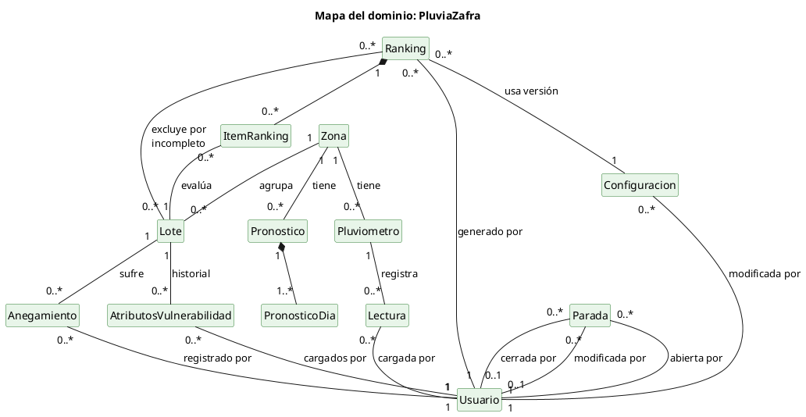

# PluviaZafra: Diagrama de clases completo

Reúne los cuatro diagramas por rol de [diagramas-clases-por-usuario.md](diagramas-clases-por-usuario.md) en un solo modelo. Las convenciones (interfaz, gestor, clase de objeto) son las mismas.

Contiene dos vistas:

1. **Diagrama completo:** interfaces, gestores y clases de objeto con todos sus miembros.
2. **Mapa del dominio:** solo las clases de objeto y los enumerados, con sus relaciones y multiplicidades. Es la vista más legible para el informe y la base para diseñar las colecciones de Firestore.

Resumen de lo que reúne:

| Capa | Cantidad | Clases |
|---|---|---|
| Interfaces | 15 | InterfazLogin, InterfazUsuarios, InterfazLotes, InterfazAtributosLote, InterfazZonas, InterfazConfiguracion, InterfazLectura, InterfazAnegamiento, InterfazPronostico, InterfazRanking, InterfazAlertaRiesgo, InterfazMapa, InterfazSimulador, InterfazParada, InterfazHistorialParadas |
| Gestores | 12 | GestorSesion, GestorUsuarios, GestorLotes, GestorAtributos, GestorIndice, GestorZonas, GestorConfiguracion, GestorLecturas, GestorAnegamientos, GestorPronostico, GestorRanking, GestorParadas |
| Clases de objeto | 13 | Usuario, Zona, Pluviometro, Lote, AtributosVulnerabilidad, Lectura, Anegamiento, Pronostico, PronosticoDia, Ranking, ItemRanking, Configuracion, Parada |
| Externo | 1 | ServicioOpenMeteo |
| Enumerados | 9 | Rol, EstadoLote, Semaforo, Suelo, Drenaje, Camino, CategoriaVulnerabilidad, CausaParada, EstadoParada |

`PronosticoDia` es parte de `Pronostico` (composición).

## 1. Diagrama completo

```plantuml
@startuml
title Diagrama de clases completo: PluviaZafra
skinparam classAttributeIconSize 0
skinparam shadowing false
hide circle
skinparam class {
  BackgroundColor<<interfaz>> #E3F2FD
  BorderColor<<interfaz>> #1565C0
  BackgroundColor<<gestor>> #FFF3E0
  BorderColor<<gestor>> #EF6C00
  BackgroundColor<<entidad>> #E8F5E9
  BorderColor<<entidad>> #2E7D32
  BackgroundColor<<externo>> #F3E5F5
  BorderColor<<externo>> #6A1B9A
  BackgroundColor<<actor>> #FFFDE7
  BorderColor<<actor>> #F9A825
}

' ---------- Actores ----------
class "Administrador" as AD <<actor>>
class "Jefe de cosecha" as JC <<actor>>
class "Operador de campo" as OP <<actor>>
class "Supervisor de fábrica" as SF <<actor>>
AD --|> JC

' ---------- Interfaces ----------
package "Interfaces" {
  class InterfazLogin <<interfaz>> {
    +mostrarFormulario()
    +enviarCredenciales(correo, clave)
    +mostrarError(mensaje)
  }
  class InterfazUsuarios <<interfaz>> {
    +listarUsuarios()
    +altaUsuario(nombre, correo, rol)
    +cambiarRol(u: Usuario, rol)
    +deshabilitar(u: Usuario)
  }
  class InterfazLotes <<interfaz>> {
    +mostrarMapaDeLotes()
    +abrirFormulario(lote)
    +dibujarPoligono()
    +mostrarAreaCalculada(ha)
    +cambiarEstado(lote, estado: EstadoLote)
    +confirmarBaja(lote)
  }
  class InterfazAtributosLote <<interfaz>> {
    +seleccionarLote()
    +mostrarAtributos(a: AtributosVulnerabilidad)
    +elegirValores(suelo, drenaje, camino)
    +mostrarIndiceEstimado(indice)
  }
  class InterfazZonas <<interfaz>> {
    +mostrarZonas()
    +abrirFormularioZona()
    +marcarPuntoReferencia()
    +registrarPluviometro()
    +confirmarReemplazo()
  }
  class InterfazConfiguracion <<interfaz>> {
    +mostrarParametros(c: Configuracion)
    +editarParametro(nombre, valor)
    +mostrarSumaDePesos()
    +restaurarValoresIniciales()
  }
  class InterfazLectura <<interfaz>> {
    +mostrarFormulario()
    +elegirZona()
    +ingresarMilimetros(mm)
    +ajustarFechaHora(fechaHora)
    +confirmarValorAlto(mm)
    +mostrarAcumulado(mm)
    +marcarAnegamiento()
  }
  class InterfazAnegamiento <<interfaz>> {
    +seleccionarLotes()
    +registrarInicio(lotes, fechaHora, obs)
    +cerrarAnegamiento(a: Anegamiento, fechaHora)
    +mostrarConfirmacion()
  }
  class InterfazPronostico <<interfaz>> {
    +solicitarPronostico()
    +mostrarPronostico(p: Pronostico)
    +mostrarDesactualizado(fechaHora)
  }
  class InterfazRanking <<interfaz>> {
    +solicitarRanking()
    +mostrarRanking(r: Ranking)
    +mostrarAvisos(avisos)
    +filtrar(zona, semaforo)
  }
  class InterfazAlertaRiesgo <<interfaz>> {
    +mostrarAlerta(lotesRojos, toneladasEnRiesgo)
    +abrirDetalleLote(codigo)
    +cerrarAlerta()
  }
  class InterfazMapa <<interfaz>> {
    +dibujarLotes(lotes)
    +mostrarLeyenda()
    +seleccionarLote(codigo)
    +mostrarDetalleLote(lote)
    +mostrarParadaAbierta(p: Parada)
  }
  class InterfazSimulador <<interfaz>> {
    +abrirSimulador()
    +ajustarLluviaZona(zona, mmAcum, mmPrev)
    +elegirEscenarioRapido(tipo)
    +mostrarResultadoSimulado(r: Ranking)
    +restablecerDatosReales()
  }
  class InterfazParada <<interfaz>> {
    +mostrarFormulario()
    +elegirCausa(causa: CausaParada)
    +ingresarDetalle(texto)
    +ingresarToneladasPatio(t)
    +confirmarApertura()
    +mostrarParadaAbierta(p: Parada)
    +confirmarCierre(fechaHora)
    +editarParadaCerrada(p: Parada)
  }
  class InterfazHistorialParadas <<interfaz>> {
    +filtrar(desde, hasta, causa)
    +mostrarListado(paradas)
    +mostrarTotales(totales)
    +mostrarDetalle(p: Parada)
    +exportarCSV()
  }
}

' ---------- Gestores ----------
package "Gestores" {
  class GestorSesion <<gestor>> {
    +iniciarSesion(correo, clave): Usuario
    +cerrarSesion()
    +obtenerRol(): Rol
  }
  class GestorUsuarios <<gestor>> {
    +crearUsuario(nombre, correo, rol): Usuario
    +cambiarRol(u: Usuario, rol)
    +deshabilitar(u: Usuario)
    +esUltimoAdministrador(u: Usuario): Boolean
    +listarUsuarios(): List<Usuario>
  }
  class GestorLotes <<gestor>> {
    +crearLote(datos): Lote
    +modificarLote(l: Lote, datos)
    +cambiarEstado(l: Lote, estado: EstadoLote)
    +darDeBaja(l: Lote)
    +tieneHistorial(l: Lote): Boolean
    +existeCodigo(codigo): Boolean
    +validarPoligono(p): Boolean
    +calcularAreaHa(p): Real
    +superponeConOtro(p): Boolean
    +listarLotes(filtro): List<Lote>
    +listarElegibles(): List<Lote>
  }
  class GestorAtributos <<gestor>> {
    +registrarAtributos(l: Lote, suelo, drenaje, camino, usuario)
    +historialDe(l: Lote): List<AtributosVulnerabilidad>
    +listarIncompletos(): List<Lote>
  }
  class GestorIndice <<gestor>> {
    +calcularIndice(lote, config): Real
    +categorizar(indice, config): CategoriaVulnerabilidad
  }
  class GestorZonas <<gestor>> {
    +crearZona(datos): Zona
    +modificarZona(z: Zona, datos)
    +darDeBajaZona(z: Zona)
    +registrarPluviometro(z: Zona, datos): Pluviometro
    +reemplazarPluviometro(z: Zona, datos)
    +desactivarPluviometro(p: Pluviometro)
    +listarZonas(): List<Zona>
    +pluviometroActivo(z: Zona): Pluviometro
  }
  class GestorConfiguracion <<gestor>> {
    +obtenerVigente(): Configuracion
    +guardar(c: Configuracion, usuario): Configuracion
    +validar(c: Configuracion): Boolean
    +restaurarPorDefecto(): Configuracion
  }
  class GestorLecturas <<gestor>> {
    +registrarLectura(zona, fechaHora, mm, usuario): Lectura
    +validarLectura(zona, fechaHora, mm): Boolean
    +existeLectura(zona, fechaHora): Boolean
    +reemplazarLectura(l: Lectura, mm)
    +acumuladoZona(zona, horas): Real
  }
  class GestorAnegamientos <<gestor>> {
    +abrir(lotes, inicio, obs, usuario)
    +cerrar(a: Anegamiento, fin)
    +listarAbiertos(): List<Anegamiento>
    +contarTotales(lote): Integer
    +contarUltimaZafra(lote): Integer
  }
  class GestorPronostico <<gestor>> {
    +consultar(zona): Pronostico
    +obtenerUltimoGuardado(zona): Pronostico
  }
  class GestorRanking <<gestor>> {
    +generarRanking(): Ranking
    +simularRanking(lluviasPorZona): Ranking
    +obtenerUltimoRanking(): Ranking
    +calcularPuntajeRiesgo(lote, lluviaAcum, lluviaPrev): Real
    +asignarSemaforo(puntaje): Semaforo
    +obtenerLotesEnRojo(r: Ranking): List<ItemRanking>
  }
  class GestorParadas <<gestor>> {
    +abrirParada(causa, detalle, inicio, toneladas, usuario): Parada
    +cerrarParada(p: Parada, fin, usuario)
    +corregirParada(p: Parada, datos, usuario)
    +obtenerAbierta(): Parada
    +listarHistorial(desde, hasta, causa): List<Parada>
    +totalesPorCausa(paradas): Totales
    +exportarCSV(paradas)
  }
}

class ServicioOpenMeteo <<externo>> {
  +consultarPronostico(latitud, longitud, horas)
}

' ---------- Clases de objeto ----------
package "Clases de objeto" {
  class Usuario <<entidad>> {
    -id: String
    -nombre: String
    -correo: String
    -rol: Rol
    -habilitado: Boolean
  }
  class Zona <<entidad>> {
    -codigo: String
    -nombre: String
    -latitud: Real
    -longitud: Real
  }
  class Pluviometro <<entidad>> {
    -codigo: String
    -latitud: Real
    -longitud: Real
    -activo: Boolean
  }
  class Lote <<entidad>> {
    -codigo: String
    -nombre: String
    -hectareas: Real
    -toneladas: Real
    -poligono: List<Coordenada>
    -estado: EstadoLote
    /semaforo: Semaforo
    +estaCompleto(): Boolean
    +esElegible(): Boolean
    +atributosVigentes(): AtributosVulnerabilidad
    +cambiarEstado(e: EstadoLote)
  }
  class AtributosVulnerabilidad <<entidad>> {
    -suelo: Suelo
    -drenaje: Drenaje
    -camino: Camino
    -fechaHora: DateTime
  }
  class Lectura <<entidad>> {
    -fechaHora: DateTime
    -milimetros: Real
  }
  class Anegamiento <<entidad>> {
    -fechaInicio: DateTime
    -fechaFin: DateTime
    -observaciones: String
    +estaAbierto(): Boolean
    +cerrar(fin: DateTime)
  }
  class Pronostico <<entidad>> {
    -fechaConsulta: DateTime
    -horizonteHoras: Integer
    +milimetrosPrevistos(): Real
  }
  class PronosticoDia <<entidad>> {
    -fecha: Date
    -milimetros: Real
  }
  class Ranking <<entidad>> {
    -fechaHora: DateTime
    +lotesEnRojo(): List<ItemRanking>
  }
  class ItemRanking <<entidad>> {
    -posicion: Integer
    -indice: Real
    -categoria: CategoriaVulnerabilidad
    -lluviaAcumulada: Real
    -lluviaPrevista: Real
    -puntajeRiesgo: Real
    -semaforo: Semaforo
    -pronosticoDesactualizado: Boolean
    -sinLecturas: Boolean
  }
  class Configuracion <<entidad>> {
    -version: Integer
    -fechaHora: DateTime
    -pesoSuelo: Real
    -pesoDrenaje: Real
    -pesoCamino: Real
    -pesoHistorial: Real
    -pesoUltimaZafra: Real
    -puntajesSuelo: Map<Suelo, Real>
    -puntajesDrenaje: Map<Drenaje, Real>
    -puntajesCamino: Map<Camino, Real>
    -topeHistorial: Integer
    -topeUltimaZafra: Integer
    -umbralCategoriaMedia: Real
    -umbralCategoriaAlta: Real
    -umbralSemaforoAmarillo: Real
    -umbralSemaforoRojo: Real
    -lluviaCriticaMm: Real
    -ventanaLluviaHoras: Integer
    -horizontePronosticoHoras: Integer
    -inicioZafra: Date
    +pesosSumanUno(): Boolean
  }
  class Parada <<entidad>> {
    -causa: CausaParada
    -detalle: String
    -fechaInicio: DateTime
    -fechaFin: DateTime
    /duracionHoras: Real
    -toneladasPatio: Real
    -estado: EstadoParada
    +estaAbierta(): Boolean
    +cerrar(fin: DateTime)
  }
}

' ---------- Enumerados ----------
package "Enumerados" {
  enum Rol {
    ADMINISTRADOR
    JEFE_COSECHA
    OPERADOR_CAMPO
    SUPERVISOR_FABRICA
  }
  enum EstadoLote {
    PENDIENTE
    ANEGADO
    EN_COSECHA
    COSECHADO
    EN_DESCANSO
  }
  enum Semaforo {
    ROJO
    AMARILLO
    VERDE
  }
  enum Suelo {
    ARENOSO
    FRANCO
    ARCILLOSO
  }
  enum Drenaje {
    BUENO
    REGULAR
    MALO
  }
  enum Camino {
    CONSOLIDADO
    ENRIPIADO
    TIERRA
  }
  enum CategoriaVulnerabilidad {
    BAJA
    MEDIA
    ALTA
  }
  enum CausaParada {
    LLUVIA
    FALTA_CANA_EN_PATIO
    AVERIA_EQUIPOS
    MANTENIMIENTO_PROGRAMADO
    OTRA
  }
  enum EstadoParada {
    ABIERTA
    CERRADA
  }
}

' ---------- Actor -> interfaz ----------
AD --> InterfazLogin
JC --> InterfazLogin
OP --> InterfazLogin
SF --> InterfazLogin
AD --> InterfazUsuarios
AD --> InterfazLotes
AD --> InterfazAtributosLote
AD --> InterfazZonas
AD --> InterfazConfiguracion
JC --> InterfazRanking
JC --> InterfazMapa
JC --> InterfazPronostico
JC --> InterfazAnegamiento
JC --> InterfazHistorialParadas
JC --> InterfazSimulador
OP --> InterfazLectura
OP --> InterfazAnegamiento
SF --> InterfazParada
SF --> InterfazHistorialParadas

' ---------- Interfaz -> gestor ----------
InterfazLogin ..> GestorSesion : usa
InterfazUsuarios ..> GestorUsuarios : usa
InterfazLotes ..> GestorLotes : usa
InterfazLotes ..> GestorZonas : usa
InterfazAtributosLote ..> GestorAtributos : usa
InterfazAtributosLote ..> GestorLotes : usa
InterfazZonas ..> GestorZonas : usa
InterfazConfiguracion ..> GestorConfiguracion : usa
InterfazLectura ..> GestorLecturas : usa
InterfazLectura ..> GestorZonas : usa
InterfazLectura ..> InterfazAnegamiento : abre si hay\nlote intransitable
InterfazAnegamiento ..> GestorAnegamientos : usa
InterfazAnegamiento ..> GestorLotes : usa
InterfazPronostico ..> GestorPronostico : usa
InterfazRanking ..> GestorRanking : usa
InterfazRanking ..> InterfazAlertaRiesgo : muestra si\nhay lotes en rojo
InterfazAlertaRiesgo ..> GestorRanking : usa
InterfazMapa ..> GestorRanking : usa
InterfazMapa ..> GestorLotes : usa
InterfazMapa ..> GestorParadas : usa
InterfazSimulador ..> GestorRanking : usa
InterfazSimulador ..> GestorZonas : usa
InterfazParada ..> GestorParadas : usa
InterfazHistorialParadas ..> GestorParadas : usa

' ---------- Gestor -> gestor / externo ----------
GestorRanking ..> GestorIndice
GestorRanking ..> GestorPronostico
GestorRanking ..> GestorLecturas
GestorRanking ..> GestorLotes
GestorRanking ..> GestorConfiguracion
GestorIndice ..> GestorAnegamientos
GestorIndice ..> GestorConfiguracion
GestorAtributos ..> GestorIndice
GestorLecturas ..> GestorConfiguracion
GestorPronostico ..> ServicioOpenMeteo

' ---------- Gestor -> entidad ----------
GestorSesion --> Usuario : gestiona
GestorUsuarios --> Usuario : gestiona
GestorLotes --> Lote : gestiona
GestorAtributos --> AtributosVulnerabilidad : gestiona
GestorZonas --> Zona : gestiona
GestorZonas --> Pluviometro : gestiona
GestorConfiguracion --> Configuracion : gestiona
GestorLecturas --> Lectura : gestiona
GestorAnegamientos --> Anegamiento : gestiona
GestorAnegamientos --> Lote : actualiza estado
GestorPronostico --> Pronostico : gestiona
GestorRanking --> Ranking : gestiona
GestorParadas --> Parada : gestiona

' ---------- Entre entidades ----------
Zona "1" -- "0..*" Lote : agrupa
Zona "1" -- "0..*" Pluviometro : tiene
Pluviometro "1" -- "0..*" Lectura : registra
Zona "1" -- "0..*" Pronostico : tiene
Pronostico "1" *-- "1..*" PronosticoDia
Lote "1" -- "0..*" AtributosVulnerabilidad : historial
Lote "1" -- "0..*" Anegamiento : sufre
Ranking "1" *-- "0..*" ItemRanking
ItemRanking "0..*" -- "1" Lote : evalúa
Ranking "0..*" -- "0..*" Lote : excluye por\nincompleto
Ranking "0..*" -- "1" Configuracion : usa versión
Ranking "0..*" -- "1" Usuario : generado por
Lectura "0..*" -- "1" Usuario : cargada por
Anegamiento "0..*" -- "1" Usuario : registrado por
AtributosVulnerabilidad "0..*" -- "1" Usuario : cargados por
Configuracion "0..*" -- "1" Usuario : modificada por
Parada "0..*" -- "1" Usuario : abierta por
Parada "0..*" -- "0..1" Usuario : cerrada por
Parada "0..*" -- "0..1" Usuario : modificada por
@enduml
```

## 2. Mapa del dominio

Solo las clases de objeto y sus relaciones, sin atributos ni métodos. Los atributos están en el diagrama completo. Los enumerados se muestran como tipo de atributo de cada clase.

## Diccionario de enumerados

| Enumerado | Valores | Usado en |
|---|---|---|
| Rol | ADMINISTRADOR, JEFE_COSECHA, OPERADOR_CAMPO, SUPERVISOR_FABRICA | Usuario |
| EstadoLote | PENDIENTE, ANEGADO, EN_COSECHA, COSECHADO, EN_DESCANSO | Lote |
| Semaforo | ROJO, AMARILLO, VERDE | Lote (derivado), ItemRanking |
| Suelo | ARENOSO, FRANCO, ARCILLOSO | AtributosVulnerabilidad, Configuracion |
| Drenaje | BUENO, REGULAR, MALO | AtributosVulnerabilidad, Configuracion |
| Camino | CONSOLIDADO, ENRIPIADO, TIERRA | AtributosVulnerabilidad, Configuracion |
| CategoriaVulnerabilidad | BAJA, MEDIA, ALTA | ItemRanking |
| CausaParada | LLUVIA, FALTA_CANA_EN_PATIO, AVERIA_EQUIPOS, MANTENIMIENTO_PROGRAMADO, OTRA | Parada |
| EstadoParada | ABIERTA, CERRADA | Parada |

Los valores de `Suelo`, `Drenaje`, `Camino` y `CausaParada` son provisorios hasta la entrevista (ver [pendientes-entrevista.md](pendientes-entrevista.md)). Si cambian, solo cambia el enumerado.

## Pendientes

- Decidir si `GestorAnegamientos` actualiza el estado del lote directo o a través de `GestorLotes`.
- Confirmar con el equipo dónde corre cada gestor (React, FastAPI o directo contra Firestore).
- Si la consigna de la cátedra exige otra notación (por ejemplo, solo clases de objeto con gestores y sin interfaces), reorganizar estas vistas.
- Próximos diagramas: secuencia (CU11, CU08, CU13), estados del lote y de la parada, y actividad del ranking.
