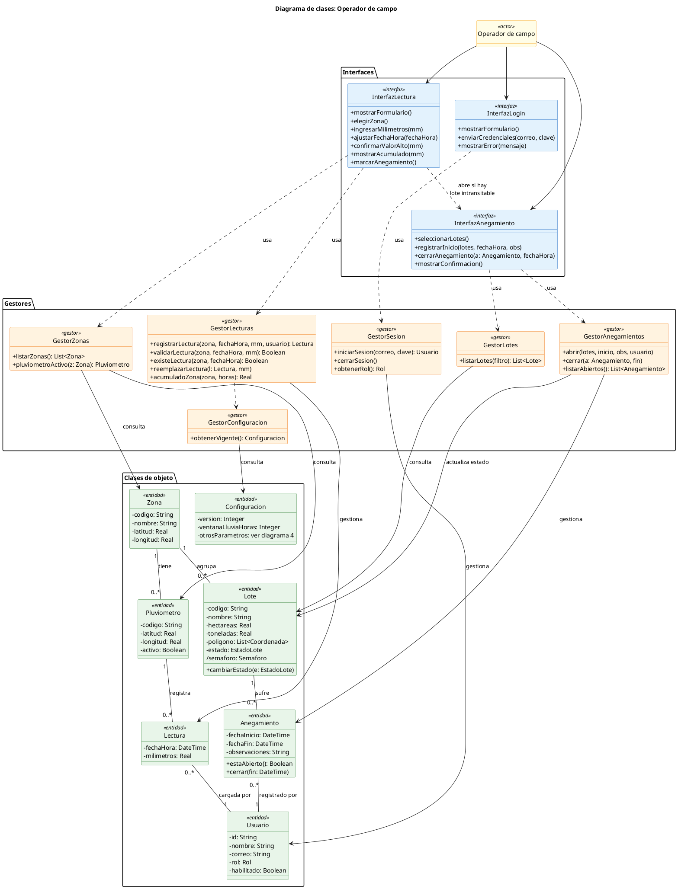
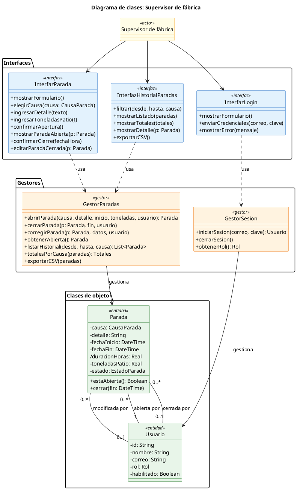
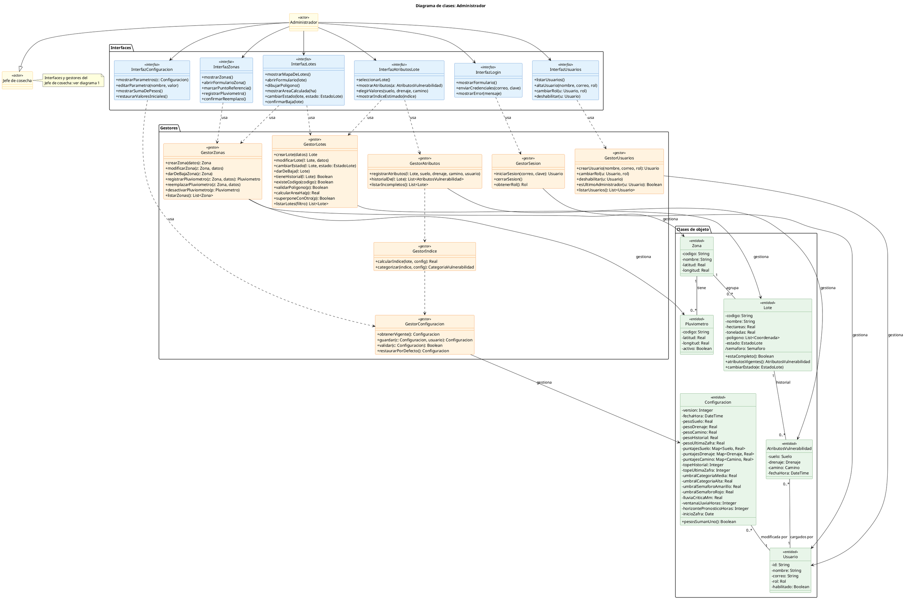

# PluviaZafra: Diagramas de clases por tipo de usuario

Proyecto: Ingenio La Esperanza (PluviaZafra). Equipo: Carpincho Software.

Un diagrama por rol, con las tres clases de siempre: **interfaces** (pantallas con las que interactúa el usuario), **gestores** (lógica de cada caso de uso) y **clases de objeto** (entidades que se guardan). El diagrama completo, que reúne todos estos, está en [diagrama-clases-completo.md](diagrama-clases-completo.md).

Casos de uso de origen: [especificaciones-casos-de-uso.md](especificaciones-casos-de-uso.md). Agrupación por rol: [casos-de-uso-por-usuario.md](casos-de-uso-por-usuario.md).

## Convenciones

| Tipo | Estereotipo | Color | Qué representa |
|---|---|---|---|
| Interfaz | `<<interfaz>>` | Azul | Pantalla o componente de React. Recibe datos del usuario y los muestra. No tiene reglas de negocio. |
| Gestor | `<<gestor>>` | Naranja | Coordina un caso de uso: valida, aplica reglas y persiste. |
| Clase de objeto | `<<entidad>>` | Verde | Dato del dominio que se guarda en Firestore. |
| Sistema externo | `<<externo>>` | Violeta | Servicio fuera del sistema (Open-Meteo). |
| Actor | `<<actor>>` | Amarillo | Persona que usa el sistema. |

Reglas de las relaciones:

- El actor se conecta con las interfaces que usa.
- La interfaz depende del gestor que le resuelve el caso de uso (flecha punteada `usa`). Nunca habla directo con las entidades.
- El gestor gestiona sus entidades (flecha continua `gestiona`) y puede depender de otros gestores.
- Entre entidades van las asociaciones del dominio, con multiplicidades.
- En cada diagrama, un gestor muestra solo los métodos que ese rol necesita. El diagrama completo los reúne.
- Los tipos enumerados (`Rol`, `EstadoLote`, `Semaforo`, `Suelo`, `Drenaje`, `Camino`, `CategoriaVulnerabilidad`, `CausaParada`, `EstadoParada`) aparecen como tipo de atributo y se definen en el diagrama completo.
- `/semaforo` y `/duracionHoras` son atributos derivados: se calculan, no se cargan a mano.

> [!NOTE]
> Dónde corre cada capa es una decisión de arquitectura todavía abierta [a definir con el equipo]. Una propuesta razonable: interfaces en React, gestores con reglas de cálculo (ranking, índice, Open-Meteo) en FastAPI, y entidades en Firestore. Los gestores de alta, baja y modificación simples podrían escribir directo en Firestore desde React, con reglas de seguridad por rol.

---

## 1. Jefe de cosecha

Casos de uso: CU01, CU05, CU09, CU11, CU12, CU14 y CU15. Es el rol más completo, porque consume casi todo el modelo.

```plantuml
@startuml
title Diagrama de clases: Jefe de cosecha
skinparam classAttributeIconSize 0
skinparam shadowing false
hide circle
skinparam class {
  BackgroundColor<<interfaz>> #E3F2FD
  BorderColor<<interfaz>> #1565C0
  BackgroundColor<<gestor>> #FFF3E0
  BorderColor<<gestor>> #EF6C00
  BackgroundColor<<entidad>> #E8F5E9
  BorderColor<<entidad>> #2E7D32
  BackgroundColor<<externo>> #F3E5F5
  BorderColor<<externo>> #6A1B9A
  BackgroundColor<<actor>> #FFFDE7
  BorderColor<<actor>> #F9A825
}

class "Jefe de cosecha" as JC <<actor>>

package "Interfaces" {
  class InterfazLogin <<interfaz>> {
    +mostrarFormulario()
    +enviarCredenciales(correo, clave)
    +mostrarError(mensaje)
  }
  class InterfazRanking <<interfaz>> {
    +solicitarRanking()
    +mostrarRanking(r: Ranking)
    +mostrarAvisos(avisos)
    +filtrar(zona, semaforo)
  }
  class InterfazAlertaRiesgo <<interfaz>> {
    +mostrarAlerta(lotesRojos, toneladasEnRiesgo)
    +abrirDetalleLote(codigo)
    +cerrarAlerta()
  }
  class InterfazMapa <<interfaz>> {
    +dibujarLotes(lotes)
    +mostrarLeyenda()
    +seleccionarLote(codigo)
    +mostrarDetalleLote(lote)
    +mostrarParadaAbierta(p: Parada)
  }
  class InterfazPronostico <<interfaz>> {
    +solicitarPronostico()
    +mostrarPronostico(p: Pronostico)
    +mostrarDesactualizado(fechaHora)
  }
  class InterfazAnegamiento <<interfaz>> {
    +seleccionarLotes()
    +registrarInicio(lotes, fechaHora, obs)
    +cerrarAnegamiento(a: Anegamiento, fechaHora)
    +mostrarConfirmacion()
  }
  class InterfazHistorialParadas <<interfaz>> {
    +filtrar(desde, hasta, causa)
    +mostrarListado(paradas)
    +mostrarTotales(totales)
    +exportarCSV()
  }
}

package "Gestores" {
  class GestorSesion <<gestor>> {
    +iniciarSesion(correo, clave): Usuario
    +cerrarSesion()
    +obtenerRol(): Rol
  }
  class GestorRanking <<gestor>> {
    +generarRanking(): Ranking
    +obtenerUltimoRanking(): Ranking
    +calcularPuntajeRiesgo(lote, lluviaAcum, lluviaPrev): Real
    +asignarSemaforo(puntaje): Semaforo
    +obtenerLotesEnRojo(r: Ranking): List<ItemRanking>
  }
  class GestorIndice <<gestor>> {
    +calcularIndice(lote, config): Real
    +categorizar(indice, config): CategoriaVulnerabilidad
  }
  class GestorPronostico <<gestor>> {
    +consultar(zona): Pronostico
    +obtenerUltimoGuardado(zona): Pronostico
  }
  class GestorLecturas <<gestor>> {
    +acumuladoZona(zona, horas): Real
  }
  class GestorAnegamientos <<gestor>> {
    +abrir(lotes, inicio, obs, usuario)
    +cerrar(a: Anegamiento, fin)
    +contarTotales(lote): Integer
    +contarUltimaZafra(lote): Integer
  }
  class GestorLotes <<gestor>> {
    +listarLotes(filtro): List<Lote>
    +listarElegibles(): List<Lote>
  }
  class GestorParadas <<gestor>> {
    +obtenerAbierta(): Parada
    +listarHistorial(desde, hasta, causa): List<Parada>
    +totalesPorCausa(paradas): Totales
  }
  class GestorConfiguracion <<gestor>> {
    +obtenerVigente(): Configuracion
  }
}

class ServicioOpenMeteo <<externo>> {
  +consultarPronostico(latitud, longitud, horas)
}

package "Clases de objeto" {
  class Usuario <<entidad>> {
    -id: String
    -nombre: String
    -correo: String
    -rol: Rol
    -habilitado: Boolean
  }
  class Zona <<entidad>> {
    -codigo: String
    -nombre: String
    -latitud: Real
    -longitud: Real
  }
  class Pluviometro <<entidad>> {
    -codigo: String
    -latitud: Real
    -longitud: Real
    -activo: Boolean
  }
  class Lote <<entidad>> {
    -codigo: String
    -nombre: String
    -hectareas: Real
    -toneladas: Real
    -poligono: List<Coordenada>
    -estado: EstadoLote
    /semaforo: Semaforo
    +estaCompleto(): Boolean
    +esElegible(): Boolean
  }
  class AtributosVulnerabilidad <<entidad>> {
    -suelo: Suelo
    -drenaje: Drenaje
    -camino: Camino
    -fechaHora: DateTime
  }
  class Lectura <<entidad>> {
    -fechaHora: DateTime
    -milimetros: Real
  }
  class Anegamiento <<entidad>> {
    -fechaInicio: DateTime
    -fechaFin: DateTime
    -observaciones: String
    +estaAbierto(): Boolean
  }
  class Pronostico <<entidad>> {
    -fechaConsulta: DateTime
    -horizonteHoras: Integer
    +milimetrosPrevistos(): Real
  }
  class PronosticoDia <<entidad>> {
    -fecha: Date
    -milimetros: Real
  }
  class Ranking <<entidad>> {
    -fechaHora: DateTime
    +lotesEnRojo(): List<ItemRanking>
  }
  class ItemRanking <<entidad>> {
    -posicion: Integer
    -indice: Real
    -categoria: CategoriaVulnerabilidad
    -lluviaAcumulada: Real
    -lluviaPrevista: Real
    -puntajeRiesgo: Real
    -semaforo: Semaforo
    -pronosticoDesactualizado: Boolean
    -sinLecturas: Boolean
  }
  class Configuracion <<entidad>> {
    -version: Integer
    -fechaHora: DateTime
    -ventanaLluviaHoras: Integer
    -horizontePronosticoHoras: Integer
    -lluviaCriticaMm: Real
    -inicioZafra: Date
    -otrosParametros: ver diagrama 4
  }
  class Parada <<entidad>> {
    -causa: CausaParada
    -detalle: String
    -fechaInicio: DateTime
    -fechaFin: DateTime
    /duracionHoras: Real
    -toneladasPatio: Real
    -estado: EstadoParada
  }
}

' Actor -> interfaces
JC --> InterfazLogin
JC --> InterfazRanking
JC --> InterfazMapa
JC --> InterfazPronostico
JC --> InterfazAnegamiento
JC --> InterfazHistorialParadas

' Interfaz -> gestor
InterfazLogin ..> GestorSesion : usa
InterfazRanking ..> GestorRanking : usa
InterfazRanking ..> InterfazAlertaRiesgo : muestra si\nhay lotes en rojo
InterfazAlertaRiesgo ..> GestorRanking : usa
InterfazMapa ..> GestorRanking : usa
InterfazMapa ..> GestorLotes : usa
InterfazMapa ..> GestorParadas : usa
InterfazPronostico ..> GestorPronostico : usa
InterfazAnegamiento ..> GestorAnegamientos : usa
InterfazAnegamiento ..> GestorLotes : usa
InterfazHistorialParadas ..> GestorParadas : usa

' Gestor -> gestor / externo
GestorRanking ..> GestorIndice
GestorRanking ..> GestorPronostico
GestorRanking ..> GestorLecturas
GestorRanking ..> GestorLotes
GestorRanking ..> GestorConfiguracion
GestorIndice ..> GestorAnegamientos
GestorIndice ..> GestorConfiguracion
GestorPronostico ..> ServicioOpenMeteo

' Gestor -> entidad
GestorSesion --> Usuario : gestiona
GestorRanking --> Ranking : gestiona
GestorPronostico --> Pronostico : gestiona
GestorLecturas --> Lectura : consulta
GestorAnegamientos --> Anegamiento : gestiona
GestorAnegamientos --> Lote : actualiza estado
GestorLotes --> Lote : consulta
GestorParadas --> Parada : consulta
GestorConfiguracion --> Configuracion : consulta

' Entre entidades
Zona "1" -- "0..*" Lote : agrupa
Zona "1" -- "0..*" Pluviometro : tiene
Pluviometro "1" -- "0..*" Lectura : registra
Zona "1" -- "0..*" Pronostico : tiene
Pronostico "1" *-- "1..*" PronosticoDia
Lote "1" -- "0..*" AtributosVulnerabilidad : historial
Lote "1" -- "0..*" Anegamiento : sufre
Ranking "1" *-- "0..*" ItemRanking
ItemRanking "0..*" -- "1" Lote : evalúa
Ranking "0..*" -- "0..*" Lote : excluye por\nincompleto
Ranking "0..*" -- "1" Configuracion : usa versión
Ranking "0..*" -- "1" Usuario : generado por
Anegamiento "0..*" -- "1" Usuario : registrado por
Parada "0..*" -- "1" Usuario : abierta por
@enduml
```

---

## 2. Operador de campo

Casos de uso: CU01, CU05 y CU08. Su carga es corta y frecuente. La interfaz de lectura puede derivar en la de anegamiento (CU05 extiende CU08).

---

## 3. Supervisor de fábrica

Casos de uso: CU01, CU13 y CU14. El modelo es chico y autocontenido: casi todo gira alrededor de la parada.

---

## 4. Administrador

Casos de uso propios: CU01, CU02, CU03, CU04, CU06 y CU07. Además hereda todo lo del Jefe de cosecha (diagrama 1), así que acá no se repite.

---

## Trazabilidad: caso de uso, interfaz, gestor y objetos

| CU | Interfaz | Gestor | Clases de objeto | Rol |
|---|---|---|---|---|
| CU01 Iniciar sesión | InterfazLogin | GestorSesion | Usuario | Todos |
| CU02 Gestionar usuarios y roles | InterfazUsuarios | GestorUsuarios | Usuario | Administrador |
| CU03 Gestionar lotes | InterfazLotes | GestorLotes | Lote, Zona | Administrador |
| CU04 Atributos de vulnerabilidad | InterfazAtributosLote | GestorAtributos, GestorIndice | AtributosVulnerabilidad, Lote | Administrador |
| CU05 Registrar anegamiento | InterfazAnegamiento | GestorAnegamientos | Anegamiento, Lote, Usuario | Operador, Jefe |
| CU06 Configurar parámetros | InterfazConfiguracion | GestorConfiguracion | Configuracion | Administrador |
| CU07 Zonas y pluviómetros | InterfazZonas | GestorZonas | Zona, Pluviometro | Administrador |
| CU08 Lectura de pluviómetro | InterfazLectura | GestorLecturas, GestorZonas | Lectura, Pluviometro, Zona | Operador |
| CU09 Consultar pronóstico | InterfazPronostico | GestorPronostico | Pronostico, PronosticoDia, Zona | Jefe |
| CU10 Calcular índice | (sin interfaz, interno) | GestorIndice | Lote, AtributosVulnerabilidad, Configuracion | Sistema |
| CU11 Generar ranking | InterfazRanking | GestorRanking | Ranking, ItemRanking, Lote | Jefe |
| CU12 Ranking en el mapa | InterfazMapa | GestorRanking, GestorLotes, GestorParadas | Lote, Ranking, Parada | Jefe |
| CU13 Registrar parada | InterfazParada | GestorParadas | Parada, Usuario | Supervisor |
| CU14 Historial de paradas | InterfazHistorialParadas | GestorParadas | Parada | Jefe, Supervisor, Administrador |
| CU15 Alertar lote en riesgo | InterfazAlertaRiesgo | GestorRanking | ItemRanking | Jefe |

## Decisiones de modelado a revisar

- **El ranking guarda su configuración.** `Ranking` apunta a la versión de `Configuracion` con que se generó, y cada guardado en CU06 crea una versión nueva. Así los rankings viejos no cambian si se ajustan los pesos.
- **Atributos con historial.** `AtributosVulnerabilidad` es una clase aparte con fecha, en vez de campos del `Lote`. El lote usa el último registro. Cuesta una clase más, pero respeta el requisito de conservar el valor anterior.
- **El semáforo no se guarda en el lote.** `/semaforo` es derivado del último ranking. El estado operativo sí es un atributo (`EstadoLote`).
- **Anegamientos.** `GestorAnegamientos` actualiza directo el estado del lote. Si preferís que pase por `GestorLotes`, se agrega una dependencia y se saca la flecha a `Lote`.
- **Lotes incompletos.** `Ranking` tiene una segunda asociación con `Lote` para listar los que quedaron afuera por faltar atributos.
- **Gestor de índice sin interfaz.** CU10 es interno: no hay pantalla propia, la usan CU11 y CU04 (para el índice estimado).

## Cómo visualizarlos

Cada bloque `plantuml` se pega en <https://www.plantuml.com/plantuml> o se renderiza con la extensión PlantUML de VS Code (requiere Java, que ya tenés instalado). Los diagramas son anchos, así que conviene exportarlos en SVG.
