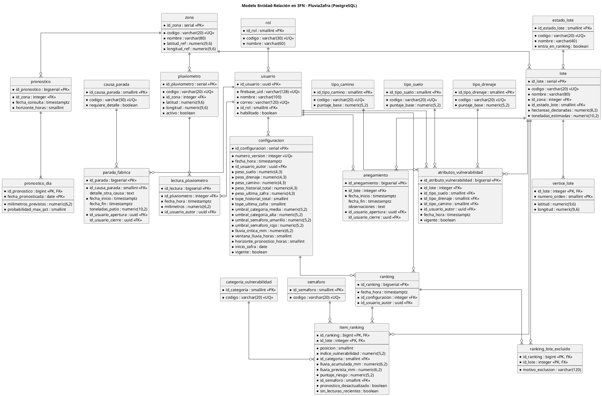

# PluviaZafra: Diseño de Base de Datos en 3FN para Firebase Data Connect (PostgreSQL)

Diseño relacional normalizado hasta **Tercera Forma Normal (3FN)** a partir del [diagrama de clases completo](diagrama-clases-completo.md) y las [reglas de negocio](compendio-definiciones-calculos.md). Está preparado para **Firebase Data Connect** (el servicio SQL de Firebase basado en Cloud SQL para PostgreSQL).

---

## 1. Justificación de normalización (1FN, 2FN y 3FN)

Para pasar del modelo de clases al modelo relacional en 3FN se aplicaron estas transformaciones:

### Primera Forma Normal (1FN): atributos atómicos y sin grupos repetitivos
- **Polígono del lote (`List<Coordenada>`):** en lugar de guardar una lista o JSON de coordenadas dentro de `lote`, se descompuso en la tabla `vertice_lote (id_lote, numero_orden, latitud, longitud)` con clave primaria compuesta `(id_lote, numero_orden)`.
- **Mapas de puntajes en Configuración (`Map<Suelo, Real>`, etc.):** se eliminaron los mapas multivaluados y se llevaron a tablas relacionales de catálogo y de puntajes por versión de configuración (`configuracion_puntaje_factor`), manteniendo valores atómicos en cada celda.
- **Lotes incompletos de un ranking:** la relación muchos a muchos entre `ranking` y `lote` para los lotes excluidos se resolvió con la tabla puente `ranking_lote_excluido (id_ranking, id_lote, motivo)`.

### Segunda Forma Normal (2FN): dependencia funcional completa de la clave primaria
En todas las tablas con clave primaria compuesta, cada atributo no clave depende de la totalidad de la clave y no de una parte:
- En `vertice_lote (id_lote, numero_orden)`, `latitud` y `longitud` dependen tanto del lote como del número de vértice.
- En `pronostico_dia (id_pronostico, fecha_pronosticada)`, los `milimetros_previstos` dependen de esa consulta de pronóstico y de ese día específico.
- En `item_ranking (id_ranking, id_lote)`, datos como `indice_vulnerabilidad`, `lluvia_acumulada_mm`, `lluvia_prevista_mm`, `puntaje_riesgo` y `posicion` dependen del lote evaluado **en ese ranking puntual**. No se incluyen acá `nombre_lote`, `hectareas` ni `id_zona`, porque dependerían solo de `id_lote`.

### Tercera Forma Normal (3FN): eliminación de dependencias transitivas
Ningún atributo no clave depende de otro atributo no clave:
- **Lecturas sin zona redundante:** `lectura` referencia únicamente a `id_pluviometro`. No guarda `id_zona` porque el pluviómetro ya pertenece a una zona (`id_pluviometro -> id_zona`); guardarla generaría una dependencia transitiva.
- **Sin atributos calculados almacenados:**
  - En `parada`, no se almacena `duracion_horas` porque depende funcionalmente de `fecha_inicio` y `fecha_fin`. Se resuelve mediante una vista o cálculo en consulta.
  - En `lote`, no se almacena `semaforo` porque depende del último ranking generado (RN07).
- **Separación de catálogos:** los roles, estados de lote, tipos de suelo, drenaje, camino y causas de parada tienen sus propias tablas de catálogo (`rol`, `estado_lote`, `tipo_suelo`, `tipo_drenaje`, `tipo_camino`, `causa_parada`), evitando repetir descripciones de texto en las tablas operativas.
- **Simulador de precipitaciones (CU16 / RN16):** como los escenarios simulados son transitorios y no persisten, no ensucian las tablas de lecturas, pronósticos ni rankings oficiales.

---

## 2. Esquema relacional en 3FN

Notación: **PK** = Clave primaria, **FK** = Clave foránea, **UQ** = Único.

### 2.1 Tablas de catálogo (Maestros estáticos)
1. **`rol`** (`id_rol` **PK**, `codigo` **UQ**, `nombre`, `descripcion`)
2. **`estado_lote`** (`id_estado_lote` **PK**, `codigo` **UQ**, `nombre`, `entra_en_ranking`, `color_hex`)
3. **`semaforo`** (`id_semaforo` **PK**, `codigo` **UQ**, `nombre`, `orden_prioridad`, `color_hex`)
4. **`categoria_vulnerabilidad`** (`id_categoria` **PK**, `codigo` **UQ**, `nombre`)
5. **`tipo_suelo`** (`id_tipo_suelo` **PK**, `codigo` **UQ**, `nombre`, `puntaje_base`)
6. **`tipo_drenaje`** (`id_tipo_drenaje` **PK**, `codigo` **UQ**, `nombre`, `puntaje_base`)
7. **`tipo_camino`** (`id_tipo_camino` **PK**, `codigo` **UQ**, `nombre`, `puntaje_base`)
8. **`causa_parada`** (`id_causa_parada` **PK**, `codigo` **UQ**, `nombre`, `requiere_detalle`)

### 2.2 Seguridad y configuración (CU01, CU02, CU06)
9. **`usuario`** (`id_usuario` **PK**, `firebase_uid` **UQ**, `nombre`, `correo` **UQ**, `id_rol` **FK**, `habilitado`, `creado_en`)
10. **`configuracion`** (`id_configuracion` **PK**, `numero_version` **UQ**, `fecha_hora`, `id_usuario_autor` **FK**, `peso_suelo`, `peso_drenaje`, `peso_camino`, `peso_historial_total`, `peso_ultima_zafra`, `tope_historial_total`, `tope_ultima_zafra`, `umbral_categoria_media`, `umbral_categoria_alta`, `umbral_semaforo_amarillo`, `umbral_semaforo_rojo`, `lluvia_critica_mm`, `ventana_lluvia_horas`, `horizonte_pronostico_horas`, `inicio_zafra`, `vigente`)

### 2.3 Territorio, lotes y vulnerabilidad (CU03, CU04, CU05, CU07)
11. **`zona`** (`id_zona` **PK**, `codigo` **UQ**, `nombre`, `latitud_ref`, `longitud_ref`, `activa`)
12. **`pluviometro`** (`id_pluviometro` **PK**, `codigo` **UQ**, `id_zona` **FK**, `latitud`, `longitud`, `activo`, `fecha_alta`, `fecha_baja`)
13. **`lote`** (`id_lote` **PK**, `codigo` **UQ**, `nombre`, `id_zona` **FK**, `id_estado_lote` **FK**, `hectareas_declaradas`, `toneladas_estimadas`, `creado_en`)
14. **`vertice_lote`** (`id_lote` **PK/FK**, `numero_orden` **PK**, `latitud`, `longitud`)
15. **`atributos_vulnerabilidad`** (`id_atributo_vulnerabilidad` **PK**, `id_lote` **FK**, `id_tipo_suelo` **FK**, `id_tipo_drenaje` **FK**, `id_tipo_camino` **FK**, `id_usuario_autor` **FK**, `fecha_hora`, `vigente`)
16. **`anegamiento`** (`id_anegamiento` **PK**, `id_lote` **FK**, `fecha_inicio`, `fecha_fin`, `observaciones`, `id_usuario_apertura` **FK**, `id_usuario_cierre` **FK**)

### 2.4 Clima, ranking y paradas de fábrica (CU08, CU09, CU11, CU13, CU14)
17. **`lectura_pluviometro`** (`id_lectura` **PK**, `id_pluviometro` **FK**, `fecha_hora`, `milimetros`, `id_usuario_autor` **FK**, **UQ**(`id_pluviometro`, `fecha_hora`))
18. **`pronostico`** (`id_pronostico` **PK**, `id_zona` **FK**, `fecha_consulta`, `horizonte_horas`, `fuente`)
19. **`pronostico_dia`** (`id_pronostico` **PK/FK**, `fecha_pronosticada` **PK**, `milimetros_previstos`, `probabilidad_max_pct`)
20. **`ranking`** (`id_ranking` **PK**, `fecha_hora`, `id_configuracion` **FK**, `id_usuario_autor` **FK**)
21. **`item_ranking`** (`id_ranking` **PK/FK**, `id_lote` **PK/FK**, `posicion`, `indice_vulnerabilidad`, `id_categoria` **FK**, `lluvia_acumulada_mm`, `lluvia_prevista_mm`, `puntaje_riesgo`, `id_semaforo` **FK**, `pronostico_desactualizado`, `sin_lecturas_recientes`)
22. **`ranking_lote_excluido`** (`id_ranking` **PK/FK**, `id_lote` **PK/FK**, `motivo_exclusion`)
23. **`parada_fabrica`** (`id_parada` **PK**, `id_causa_parada` **FK**, `detalle_otra_causa`, `fecha_inicio`, `fecha_fin`, `toneladas_patio`, `id_usuario_apertura` **FK**, `id_usuario_cierre` **FK**, `id_usuario_modificacion` **FK**, `fecha_modificacion`)

---

## 3. Diagrama Entidad-Relación (PlantUML)



---

## 4. Script DDL en PostgreSQL (Cloud SQL / Firebase Data Connect)

Este script crea todas las tablas en 3FN junto con las restricciones de integridad que garantizan las reglas de negocio (RN01 a RN16) desde el propio motor de base de datos:

```sql
-- ============================================================================
-- PLUVIAZAFRA - ESQUEMA RELACIONAL EN 3FN (PostgreSQL / Firebase Data Connect)
-- ============================================================================

CREATE EXTENSION IF NOT EXISTS "pgcrypto";

-- ----------------------------------------------------------------------------
-- 1. CATÁLOGOS
-- ----------------------------------------------------------------------------

CREATE TABLE rol (
    id_rol SMALLINT PRIMARY KEY,
    codigo VARCHAR(30) NOT NULL UNIQUE,
    nombre VARCHAR(60) NOT NULL,
    descripcion TEXT
);

CREATE TABLE estado_lote (
    id_estado_lote SMALLINT PRIMARY KEY,
    codigo VARCHAR(20) NOT NULL UNIQUE,
    nombre VARCHAR(40) NOT NULL,
    entra_en_ranking BOOLEAN NOT NULL DEFAULT FALSE,
    color_hex CHAR(7) NOT NULL
);

CREATE TABLE semaforo (
    id_semaforo SMALLINT PRIMARY KEY,
    codigo VARCHAR(20) NOT NULL UNIQUE,
    nombre VARCHAR(30) NOT NULL,
    orden_prioridad SMALLINT NOT NULL UNIQUE,
    color_hex CHAR(7) NOT NULL
);

CREATE TABLE categoria_vulnerabilidad (
    id_categoria SMALLINT PRIMARY KEY,
    codigo VARCHAR(20) NOT NULL UNIQUE,
    nombre VARCHAR(30) NOT NULL
);

CREATE TABLE tipo_suelo (
    id_tipo_suelo SMALLINT PRIMARY KEY,
    codigo VARCHAR(20) NOT NULL UNIQUE,
    nombre VARCHAR(40) NOT NULL,
    puntaje_base NUMERIC(5,2) NOT NULL CHECK (puntaje_base BETWEEN 0 AND 100)
);

CREATE TABLE tipo_drenaje (
    id_tipo_drenaje SMALLINT PRIMARY KEY,
    codigo VARCHAR(20) NOT NULL UNIQUE,
    nombre VARCHAR(40) NOT NULL,
    puntaje_base NUMERIC(5,2) NOT NULL CHECK (puntaje_base BETWEEN 0 AND 100)
);

CREATE TABLE tipo_camino (
    id_tipo_camino SMALLINT PRIMARY KEY,
    codigo VARCHAR(20) NOT NULL UNIQUE,
    nombre VARCHAR(40) NOT NULL,
    puntaje_base NUMERIC(5,2) NOT NULL CHECK (puntaje_base BETWEEN 0 AND 100)
);

CREATE TABLE causa_parada (
    id_causa_parada SMALLINT PRIMARY KEY,
    codigo VARCHAR(30) NOT NULL UNIQUE,
    nombre VARCHAR(60) NOT NULL,
    requiere_detalle BOOLEAN NOT NULL DEFAULT FALSE
);

-- ----------------------------------------------------------------------------
-- 2. USUARIOS Y CONFIGURACIÓN VERSIONADA
-- ----------------------------------------------------------------------------

CREATE TABLE usuario (
    id_usuario UUID PRIMARY KEY DEFAULT gen_random_uuid(),
    firebase_uid VARCHAR(128) NOT NULL UNIQUE,
    nombre VARCHAR(100) NOT NULL,
    correo VARCHAR(120) NOT NULL UNIQUE,
    id_rol SMALLINT NOT NULL REFERENCES rol(id_rol),
    habilitado BOOLEAN NOT NULL DEFAULT TRUE,
    creado_en TIMESTAMPTZ NOT NULL DEFAULT NOW()
);

CREATE TABLE configuracion (
    id_configuracion SERIAL PRIMARY KEY,
    numero_version INTEGER NOT NULL UNIQUE,
    fecha_hora TIMESTAMPTZ NOT NULL DEFAULT NOW(),
    id_usuario_autor UUID NOT NULL REFERENCES usuario(id_usuario),
    peso_suelo NUMERIC(4,3) NOT NULL CHECK (peso_suelo >= 0),
    peso_drenaje NUMERIC(4,3) NOT NULL CHECK (peso_drenaje >= 0),
    peso_camino NUMERIC(4,3) NOT NULL CHECK (peso_camino >= 0),
    peso_historial_total NUMERIC(4,3) NOT NULL CHECK (peso_historial_total >= 0),
    peso_ultima_zafra NUMERIC(4,3) NOT NULL CHECK (peso_ultima_zafra >= 0),
    tope_historial_total SMALLINT NOT NULL CHECK (tope_historial_total > 0),
    tope_ultima_zafra SMALLINT NOT NULL CHECK (tope_ultima_zafra > 0),
    umbral_categoria_media NUMERIC(5,2) NOT NULL,
    umbral_categoria_alta NUMERIC(5,2) NOT NULL,
    umbral_semaforo_amarillo NUMERIC(5,2) NOT NULL,
    umbral_semaforo_rojo NUMERIC(5,2) NOT NULL,
    lluvia_critica_mm NUMERIC(6,2) NOT NULL CHECK (lluvia_critica_mm > 0),
    ventana_lluvia_horas SMALLINT NOT NULL CHECK (ventana_lluvia_horas IN (24, 48, 72)),
    horizonte_pronostico_horas SMALLINT NOT NULL CHECK (horizonte_pronostico_horas IN (24, 48, 72)),
    inicio_zafra DATE NOT NULL,
    vigente BOOLEAN NOT NULL DEFAULT TRUE,
    -- RN06: la suma de los 5 pesos debe ser 1
    CONSTRAINT chk_pesos_suman_uno CHECK (
        peso_suelo + peso_drenaje + peso_camino + peso_historial_total + peso_ultima_zafra = 1.000
    ),
    CONSTRAINT chk_umbrales_categoria CHECK (
        0 < umbral_categoria_media AND umbral_categoria_media < umbral_categoria_alta AND umbral_categoria_alta <= 100
    ),
    CONSTRAINT chk_umbrales_semaforo CHECK (
        0 < umbral_semaforo_amarillo AND umbral_semaforo_amarillo < umbral_semaforo_rojo AND umbral_semaforo_rojo <= 100
    )
);

-- Solo una configuración vigente a la vez
CREATE UNIQUE INDEX uq_configuracion_vigente ON configuracion (vigente) WHERE vigente = TRUE;

-- ----------------------------------------------------------------------------
-- 3. ZONAS, PLUVIÓMETROS Y LOTES
-- ----------------------------------------------------------------------------

CREATE TABLE zona (
    id_zona SERIAL PRIMARY KEY,
    codigo VARCHAR(20) NOT NULL UNIQUE,
    nombre VARCHAR(80) NOT NULL,
    latitud_ref NUMERIC(9,6) NOT NULL CHECK (latitud_ref BETWEEN -90 AND 90),
    longitud_ref NUMERIC(9,6) NOT NULL CHECK (longitud_ref BETWEEN -180 AND 180),
    activa BOOLEAN NOT NULL DEFAULT TRUE
);

CREATE TABLE pluviometro (
    id_pluviometro SERIAL PRIMARY KEY,
    codigo VARCHAR(20) NOT NULL UNIQUE,
    id_zona INTEGER NOT NULL REFERENCES zona(id_zona) ON DELETE RESTRICT,
    latitud NUMERIC(9,6) NOT NULL CHECK (latitud BETWEEN -90 AND 90),
    longitud NUMERIC(9,6) NOT NULL CHECK (longitud BETWEEN -180 AND 180),
    activo BOOLEAN NOT NULL DEFAULT TRUE,
    fecha_alta TIMESTAMPTZ NOT NULL DEFAULT NOW(),
    fecha_baja TIMESTAMPTZ
);

-- RN04: un solo pluviómetro activo por zona
CREATE UNIQUE INDEX uq_pluviometro_activo_por_zona ON pluviometro (id_zona) WHERE activo = TRUE;

CREATE TABLE lote (
    id_lote SERIAL PRIMARY KEY,
    codigo VARCHAR(20) NOT NULL UNIQUE, -- RN01
    nombre VARCHAR(80) NOT NULL,
    id_zona INTEGER NOT NULL REFERENCES zona(id_zona) ON DELETE RESTRICT, -- RN03
    id_estado_lote SMALLINT NOT NULL REFERENCES estado_lote(id_estado_lote),
    hectareas_declaradas NUMERIC(8,2) NOT NULL CHECK (hectareas_declaradas > 0),
    toneladas_estimadas NUMERIC(10,2) NOT NULL CHECK (toneladas_estimadas > 0),
    creado_en TIMESTAMPTZ NOT NULL DEFAULT NOW()
);

-- 1FN: polígono descompuesto en vértices ordenados
CREATE TABLE vertice_lote (
    id_lote INTEGER NOT NULL REFERENCES lote(id_lote) ON DELETE CASCADE,
    numero_orden SMALLINT NOT NULL CHECK (numero_orden >= 1),
    latitud NUMERIC(9,6) NOT NULL CHECK (latitud BETWEEN -90 AND 90),
    longitud NUMERIC(9,6) NOT NULL CHECK (longitud BETWEEN -180 AND 180),
    PRIMARY KEY (id_lote, numero_orden)
);

-- RN11: historial de atributos de vulnerabilidad del lote
CREATE TABLE atributos_vulnerabilidad (
    id_atributo_vulnerabilidad BIGSERIAL PRIMARY KEY,
    id_lote INTEGER NOT NULL REFERENCES lote(id_lote) ON DELETE RESTRICT,
    id_tipo_suelo SMALLINT NOT NULL REFERENCES tipo_suelo(id_tipo_suelo),
    id_tipo_drenaje SMALLINT NOT NULL REFERENCES tipo_drenaje(id_tipo_drenaje),
    id_tipo_camino SMALLINT NOT NULL REFERENCES tipo_camino(id_tipo_camino),
    id_usuario_autor UUID NOT NULL REFERENCES usuario(id_usuario),
    fecha_hora TIMESTAMPTZ NOT NULL DEFAULT NOW(),
    vigente BOOLEAN NOT NULL DEFAULT TRUE
);

CREATE UNIQUE INDEX uq_atributos_vigentes_por_lote ON atributos_vulnerabilidad (id_lote) WHERE vigente = TRUE;

CREATE TABLE anegamiento (
    id_anegamiento BIGSERIAL PRIMARY KEY,
    id_lote INTEGER NOT NULL REFERENCES lote(id_lote) ON DELETE RESTRICT,
    fecha_inicio TIMESTAMPTZ NOT NULL,
    fecha_fin TIMESTAMPTZ,
    observaciones TEXT,
    id_usuario_apertura UUID NOT NULL REFERENCES usuario(id_usuario),
    id_usuario_cierre UUID REFERENCES usuario(id_usuario),
    CONSTRAINT chk_fechas_anegamiento CHECK (fecha_fin IS NULL OR fecha_fin >= fecha_inicio)
);

-- RN14: un lote no puede tener más de un anegamiento abierto a la vez
CREATE UNIQUE INDEX uq_anegamiento_abierto_por_lote ON anegamiento (id_lote) WHERE fecha_fin IS NULL;

-- ----------------------------------------------------------------------------
-- 4. CLIMA, PRONÓSTICO Y RANKING
-- ----------------------------------------------------------------------------

CREATE TABLE lectura_pluviometro (
    id_lectura BIGSERIAL PRIMARY KEY,
    id_pluviometro INTEGER NOT NULL REFERENCES pluviometro(id_pluviometro) ON DELETE RESTRICT,
    fecha_hora TIMESTAMPTZ NOT NULL,
    milimetros NUMERIC(6,2) NOT NULL CHECK (milimetros >= 0),
    id_usuario_autor UUID NOT NULL REFERENCES usuario(id_usuario),
    UNIQUE (id_pluviometro, fecha_hora)
);

CREATE TABLE pronostico (
    id_pronostico BIGSERIAL PRIMARY KEY,
    id_zona INTEGER NOT NULL REFERENCES zona(id_zona) ON DELETE RESTRICT,
    fecha_consulta TIMESTAMPTZ NOT NULL DEFAULT NOW(),
    horizonte_horas SMALLINT NOT NULL CHECK (horizonte_horas IN (24, 48, 72)),
    fuente VARCHAR(40) NOT NULL DEFAULT 'Open-Meteo'
);

CREATE TABLE pronostico_dia (
    id_pronostico BIGINT NOT NULL REFERENCES pronostico(id_pronostico) ON DELETE CASCADE,
    fecha_pronosticada DATE NOT NULL,
    milimetros_previstos NUMERIC(6,2) NOT NULL CHECK (milimetros_previstos >= 0),
    probabilidad_max_pct SMALLINT CHECK (probabilidad_max_pct BETWEEN 0 AND 100),
    PRIMARY KEY (id_pronostico, fecha_pronosticada)
);

CREATE TABLE ranking (
    id_ranking BIGSERIAL PRIMARY KEY,
    fecha_hora TIMESTAMPTZ NOT NULL DEFAULT NOW(),
    id_configuracion INTEGER NOT NULL REFERENCES configuracion(id_configuracion), -- RN10
    id_usuario_autor UUID NOT NULL REFERENCES usuario(id_usuario)
);

CREATE TABLE item_ranking (
    id_ranking BIGINT NOT NULL REFERENCES ranking(id_ranking) ON DELETE CASCADE,
    id_lote INTEGER NOT NULL REFERENCES lote(id_lote) ON DELETE RESTRICT,
    posicion SMALLINT NOT NULL CHECK (posicion >= 1),
    indice_vulnerabilidad NUMERIC(5,2) NOT NULL CHECK (indice_vulnerabilidad BETWEEN 0 AND 100),
    id_categoria SMALLINT NOT NULL REFERENCES categoria_vulnerabilidad(id_categoria),
    lluvia_acumulada_mm NUMERIC(6,2) NOT NULL CHECK (lluvia_acumulada_mm >= 0),
    lluvia_prevista_mm NUMERIC(6,2) NOT NULL CHECK (lluvia_prevista_mm >= 0),
    puntaje_riesgo NUMERIC(5,2) NOT NULL CHECK (puntaje_riesgo BETWEEN 0 AND 100),
    id_semaforo SMALLINT NOT NULL REFERENCES semaforo(id_semaforo),
    pronostico_desactualizado BOOLEAN NOT NULL DEFAULT FALSE,
    sin_lecturas_recientes BOOLEAN NOT NULL DEFAULT FALSE,
    PRIMARY KEY (id_ranking, id_lote),
    UNIQUE (id_ranking, posicion)
);

CREATE TABLE ranking_lote_excluido (
    id_ranking BIGINT NOT NULL REFERENCES ranking(id_ranking) ON DELETE CASCADE,
    id_lote INTEGER NOT NULL REFERENCES lote(id_lote) ON DELETE RESTRICT,
    motivo_exclusion VARCHAR(120) NOT NULL,
    PRIMARY KEY (id_ranking, id_lote)
);

-- ----------------------------------------------------------------------------
-- 5. PARADAS DE FÁBRICA
-- ----------------------------------------------------------------------------

CREATE TABLE parada_fabrica (
    id_parada BIGSERIAL PRIMARY KEY,
    id_causa_parada SMALLINT NOT NULL REFERENCES causa_parada(id_causa_parada),
    detalle_otra_causa TEXT,
    fecha_inicio TIMESTAMPTZ NOT NULL,
    fecha_fin TIMESTAMPTZ,
    toneladas_patio NUMERIC(10,2) CHECK (toneladas_patio >= 0),
    id_usuario_apertura UUID NOT NULL REFERENCES usuario(id_usuario),
    id_usuario_cierre UUID REFERENCES usuario(id_usuario),
    id_usuario_modificacion UUID REFERENCES usuario(id_usuario),
    fecha_modificacion TIMESTAMPTZ,
    CONSTRAINT chk_fechas_parada CHECK (fecha_fin IS NULL OR fecha_fin >= fecha_inicio)
);

-- RN12: solo puede haber una parada abierta a la vez en toda la fábrica
CREATE UNIQUE INDEX uq_unica_parada_abierta ON parada_fabrica ((1)) WHERE fecha_fin IS NULL;

-- ----------------------------------------------------------------------------
-- 6. VISTA PARA ATRIBUTOS DERIVADOS (Respeta 3FN sin guardar cálculos)
-- ----------------------------------------------------------------------------

CREATE VIEW vw_parada_fabrica_con_duracion AS
SELECT
    p.id_parada,
    c.codigo AS codigo_causa,
    c.nombre AS nombre_causa,
    p.detalle_otra_causa,
    p.fecha_inicio,
    p.fecha_fin,
    CASE
        WHEN p.fecha_fin IS NULL THEN 'ABIERTA'
        ELSE 'CERRADA'
    END AS estado_parada,
    ROUND(EXTRACT(EPOCH FROM (COALESCE(p.fecha_fin, NOW()) - p.fecha_inicio)) / 3600.0, 2) AS duracion_horas,
    p.toneladas_patio,
    p.id_usuario_apertura,
    p.id_usuario_cierre
FROM parada_fabrica p
JOIN causa_parada c ON c.id_causa_parada = p.id_causa_parada;
```

---

## 5. Esquema `schema.gql` para Firebase Data Connect

Si usan el SDK generador de **Firebase Data Connect** (`dataconnect/schema/schema.gql`), Firebase toma las definiciones con directivas `@table` y `@ref` y genera tanto las tablas en Cloud SQL PostgreSQL como los conectores tipados para React:

```graphql
type Rol @table(name: "rol", key: "idRol") {
  idRol: Int! @col(name: "id_rol")
  codigo: String! @unique
  nombre: String!
}

type Usuario @table(name: "usuario", key: "idUsuario") {
  idUsuario: UUID! @default(expr: "uuidV4()") @col(name: "id_usuario")
  firebaseUid: String! @unique @col(name: "firebase_uid")
  nombre: String!
  correo: String! @unique
  rol: Rol! @ref(fields: "idRol", references: "idRol")
  idRol: Int! @col(name: "id_rol")
  habilitado: Boolean! @default(value: true)
}

type Zona @table(name: "zona", key: "idZona") {
  idZona: Int! @col(name: "id_zona")
  codigo: String! @unique
  nombre: String!
  latitudRef: Float! @col(name: "latitud_ref")
  longitudRef: Float! @col(name: "longitud_ref")
  activa: Boolean! @default(value: true)
}

type Pluviometro @table(name: "pluviometro", key: "idPluviometro") {
  idPluviometro: Int! @col(name: "id_pluviometro")
  codigo: String! @unique
  zona: Zona!
  latitud: Float!
  longitud: Float!
  activo: Boolean! @default(value: true)
}

type EstadoLote @table(name: "estado_lote", key: "idEstadoLote") {
  idEstadoLote: Int! @col(name: "id_estado_lote")
  codigo: String! @unique
  nombre: String!
  entraEnRanking: Boolean! @col(name: "entra_en_ranking")
  colorHex: String! @col(name: "color_hex")
}

type Lote @table(name: "lote", key: "idLote") {
  idLote: Int! @col(name: "id_lote")
  codigo: String! @unique
  nombre: String!
  zona: Zona!
  estadoLote: EstadoLote!
  hectareasDeclaradas: Float! @col(name: "hectareas_declaradas")
  toneladasEstimadas: Float! @col(name: "toneladas_estimadas")
}

type VerticeLote @table(name: "vertice_lote", key: ["lote", "numeroOrden"]) {
  lote: Lote!
  numeroOrden: Int! @col(name: "numero_orden")
  latitud: Float!
  longitud: Float!
}

type LecturaPluviometro @table(name: "lectura_pluviometro", key: "idLectura") {
  idLectura: Int64! @col(name: "id_lectura")
  pluviometro: Pluviometro!
  fechaHora: Timestamp! @col(name: "fecha_hora")
  milimetros: Float!
  usuarioAutor: Usuario!
}

type Anegamiento @table(name: "anegamiento", key: "idAnegamiento") {
  idAnegamiento: Int64! @col(name: "id_anegamiento")
  lote: Lote!
  fechaInicio: Timestamp! @col(name: "fecha_inicio")
  fechaFin: Timestamp @col(name: "fecha_fin")
  observaciones: String
  usuarioApertura: Usuario!
  usuarioCierre: Usuario
}

type ParadaFabrica @table(name: "parada_fabrica", key: "idParada") {
  idParada: Int64! @col(name: "id_parada")
  idCausaParada: Int! @col(name: "id_causa_parada")
  detalleOtraCausa: String @col(name: "detalle_otra_causa")
  fechaInicio: Timestamp! @col(name: "fecha_inicio")
  fechaFin: Timestamp @col(name: "fecha_fin")
  toneladasPatio: Float @col(name: "toneladas_patio")
  usuarioApertura: Usuario!
  usuarioCierre: Usuario
}
```
